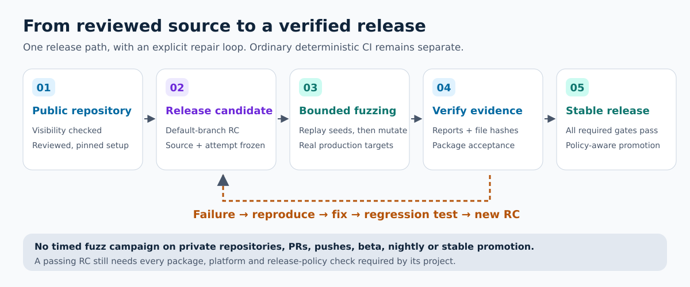

# Venus OS CI Toolkit

See [governance](GOVERNANCE.md), [community conduct](CODE_OF_CONDUCT.md) and
[architecture, security evidence and roadmap](docs/project-assurance.md). The live
OpenSSF assessment records the currently achieved level and remaining criteria.

The toolkit publishes versioned source candidates with an explicit file inventory
and acceptance tests against the extracted archive. See [source installation and
RC qualification](docs/self-release.md); consumer workflow references remain
independent, reviewed commit pins.

For bug reports, proposed changes and local verification, see
[CONTRIBUTING.md](CONTRIBUTING.md). Security reports use the private process in
[SECURITY.md](SECURITY.md). The toolkit is distributed under the [MIT license](LICENSE).

[CI dependency updates](docs/DEPENDENCY_UPDATES.md): Renovate updates related
actions and reusable workflows together, with required consistency checks.

[RC-only fuzzing](docs/rc-fuzzing.md) provides a shared, bounded input-testing
workflow for public release candidates. Consumers supply real application
targets and locked build steps; private repositories, PRs, beta, nightly and
stable runs do not launch fuzz campaigns. Reports bind each result to its source
and run attempt and become part of the candidate's release inventory.

Explore the [illustrated release process and verified rollout results](docs/rc-fuzzing-results.md), with SVG diagrams and links to the accepted RC reports.

## Operator inventories

For encrypted operator inputs and recovery, see the [secret control plane](docs/SECRETS.md).
It separates public tooling from a local private catalog and explains OCI/HCP
publication, credential rotation, independent backups, and recovery drills.
Start with the [offline synthetic recovery exercise](docs/SECRETS_DRILL.md);
it does not need cloud credentials or production data.

See [public source and operator configuration](docs/OPERATOR_CONFIG.md) before
updating a local fleet or private-runner operator installation. Public source
contains public inventory and synthetic examples; reviewed operational metadata
lives outside the checkout. Preparing that configuration does not switch runners.

For runner recovery, start with the [ARC recovery and reuse index](docs/ARC_RECOVERY.md),
including portable held examples, storage boundaries and acceptance criteria.

## Runtime scope

The CI workflows run in GitHub Actions; they are not a service installed on Venus OS.
A green workflow on an x86 Linux runner does not establish compatibility with
Cerbo GX ARMv7 or Raspberry Pi firmware. Consumers shipping native GX services
should separately exercise BusyBox/POSIX installers, offline dependency failure,
repeated installation, `/data/rc.local` boot persistence, bounded logs, and the
actual firmware Python ABI. Venus OS uses daemontools (`svc`, `svstat`), not
systemd; container jobs are companion-host build/test environments.

Reusable GitHub Actions workflows and composite actions for Victron Venus OS projects.

## Automatic approval and merge

Copy the [approval caller](docs/examples/auto-approve.yml) and [merge caller](docs/examples/auto-merge.yml) into `.github/workflows/` in each consumer, replacing `TOOLKIT_COMMIT_SHA` with a reviewed immutable commit from this repository. The metadata-only callers use `pull_request` for same-repository branches from trusted human or Renovate authors. Dependabot and forks use `pull_request_target` against the default branch, so GitHub provides the base workflow context and Actions secrets needed for merging. They invoke pinned reusable code without checking out PR source. This preserves the existing trust in repository branch writers and lets an installation PR receive its first independent bot approval. For repositories that do not trust branch writers with workflow definitions, use only `pull_request_target` and arrange the initial human review.

Ready PRs from trusted authors targeting the default branch receive automatic approval regardless of labels. The default trusted authors are `4alvit`, `californiantiramisu`, `dependabot[bot]`, and `renovate[bot]`; the event actor does not decide eligibility. Drafts and other authors are left for manual review. Add the `automerge` label only when automatic merging is wanted; approval alone does not enable it.

Keep the merge caller's top-level `permissions` at `contents: read`. Grant `pull-requests: write` only to the jobs calling the reusable merge workflow, including its withdrawal job. Those jobs also retain `contents: read`; they do not need `contents: write` or `checks: read` on `GITHUB_TOKEN`, because merge mutations and check lookups use the explicitly forwarded `BOT_PAT`. Existing callers can adopt this permission layout independently of their event conditions and runner selection.

Dependabot PRs are approved as `github-actions[bot]` using the caller's automatic `GITHUB_TOKEN` with `pull-requests: write`. Enable **Allow GitHub Actions to create and approve pull requests** in repository Actions settings. No `BOT_PAT` or `APPROVAL_PAT` Dependabot secret is needed for approval. Credential selection uses the PR author, not the actor who labels or reruns it. This routing change preserves `GITHUB_TOKEN` approval for Dependabot and `BOT_PAT` approval/merge for human-authored changes. Updating only the reusable-workflow SHA does not change a caller event condition: refresh the example caller conditions once.

For other trusted authors, including `4alvit`, forward `BOT_PAT` explicitly. Approval still prefers the independent reviewer behind `BOT_PAT` and applies to the current commit. For a PR authored by the account behind `BOT_PAT`, a separate reviewer's `APPROVAL_PAT` takes precedence. A same-repository PR from the configured bot account `californiantiramisu` can fall back to `GITHUB_TOKEN` as the independent `github-actions[bot]` reviewer, but only after verifying that `BOT_PAT` belongs to that author. Forks, other authors and manual recovery do not use this fallback; the workflow never approves as the PR author. Missing credentials fail with a configuration error instead of silently skipping an expected approval. Merging continues to use `BOT_PAT` for all authors, preserving PAT-triggered downstream workflows; its account needs repository write access and native auto-merge must be enabled.

The account behind `BOT_PAT` must have a verified email and **Keep my email addresses private** enabled in GitHub email settings before using native auto-merge. Native requests use GitHub's account-default email selection: the workflow validates the authenticated user but omits an explicit author email because GitHub can reject an explicit noreply address when enabling auto-merge even for a verified account. Direct merges still pass the authenticated account's canonical noreply address. GitHub may retain a different original PR author for squash commits; successful request acceptance does not guarantee every resulting commit identity. Verify the actual merge author and committer when a repository enforces an email boundary. The workflow does not read private email addresses or inspect the account's email-privacy setting.

For a classic `BOT_PAT` that merges workflow changes, include the [`workflow` scope](https://docs.github.com/en/apps/oauth-apps/building-oauth-apps/scopes-for-oauth-apps#available-scopes) alongside the appropriate repository scope. Repository write access alone does not grant this token permission. GitHub can reject a merge that combines workflow changes even when the bot successfully approved the PR.

If GitHub requires reapproval after the base branch changes, rerun the approval workflow. An existing same-head approval is refreshed only when GitHub reports `REVIEW_REQUIRED`; each reviewer records both the default-branch tip and GitHub's observed PR base commit to avoid repeating an approval for the same head and base context. The workflow rechecks both branch tips and PR eligibility before submitting a review, and does not repeat an approval when GitHub reports `CHANGES_REQUESTED`.

Before requesting native auto-merge, the workflow waits for the latest attempt of each reported check to pass, including optional checks, for up to two hours. It then requests GitHub native auto-merge for the verified head. Existing review requirements, CODEOWNERS, branch protection, and merge rules remain in force. If a check fails or the wait expires, fix or rerun that check and rerun the merge workflow. A new commit, label change, or ready transition starts a fresh evaluation.

An explicit GitHub `UNKNOWN` merge state gets at most four metadata reads with three four-second waits, inside the existing job timeout. Every read rechecks PR identity, head, base, eligibility and absence of an existing request; the legacy checked path also retains its exact successful-check fingerprint. Missing or invalid metadata, API errors and mutation failures are never retried.

Native waiting paths use an exact-head GraphQL enable request and recheck eligibility after the response. If withdrawal happened while enable was in flight, cleanup applies only to the acknowledged request with unchanged PR identity, request settings and current withdrawal state. Existing requests, replacements and restored opt-in are preserved. Callers must retain independent withdrawal groups and use `cancel-in-progress: false` so a later positive event cannot abort this cleanup; pending positive evaluations may still coalesce.

GitHub exposes no request ID or conditional disable operation. The final read and disable are not atomic, and a request may merge before cleanup, an API response may be lost, or a user may cancel the workflow. These cases are not covered by an atomic withdrawal guarantee. Immediate protected merges keep exact-head matching and are reported separately from enabling native auto-merge.

GitHub can retain an enabled native auto-merge request when a contributor with write access pushes another commit. That existing request follows repository requirements and can merge before optional checks finish. Before updating such a PR, disable its old request with `gh pr merge PR_NUMBER --repo OWNER/REPO --disable-auto`, then push the new commit. The fresh workflow run will request auto-merge after checking the new head.

Concurrent GitHub runs can start in a different order from their numeric run IDs. Pending attempts always block merging; completed attempts are ordered by when their jobs started, with job IDs as a fallback. An earlier canceled attempt cannot replace a later successful result, and an earlier success cannot hide a later failure.

## CodeRabbit reviews

The [CodeRabbit integration](docs/CODERABBIT.md) requests one advisory review as
`californiantiramisu` when a PR opens in a public repository with fewer than 10
stars, including drafts and forks. Copy the [pinned caller template](docs/examples/coderabbit-review.yml)
after installing the CodeRabbit app. It verifies repository visibility and bot
identity and avoids duplicate requests without checking out PR code.

The optional [Review policy](docs/REVIEW_POLICY.md) requires a current-head
independent approval and can explicitly accept a verified CodeRabbit rate-limit
status. It preserves required CI and unresolved-thread protections without
manufacturing an approval. Adoption changes native approval rules deliberately;
copy both trusted-evaluator and unprivileged review-event caller templates.

## CI and release documentation

[ESP browser installation](docs/ESP_WEB_INSTALLER.md) turns verified public factory
firmware into a board-specific USB installer with a shared action and optional
GitHub Pages deployment. Images, setup instructions and release gates remain
owned by each firmware project.

The [private OTTPlay k3s runner configuration](docs/ottplay-k3s-runners.md) adds
an opt-in GitHub/ARC switch, ephemeral worker images and a verified manual
activation command. It does not alter the fleet's default execution policy.

The [change-scope guide](docs/CHANGE_SCOPE.md) describes documentation-only checks,
full release qualification and per-repository exceptions. Generated pipelines
skip heavy builds and automatic releases for verified documentation-only changes.

See the [fleet rollout guide](docs/FLEET_ROLLOUT.md), [local nightly runner](docs/LOCAL_NIGHTLY.md), and [toolkit operations](docs/release-workflow.md). Application repositories keep their strategy in `RELEASING.md` and commands in `docs/release-workflow.md`; README files only link to them. The canonical English strategy is [templates/release-strategy.md](templates/release-strategy.md). The [application release runbook](docs/APPLICATION_RELEASES.md) covers request ordering, workflow-change recovery, approval and stable promotion across public applications.

Private repositories run ordinary OSS checks locally. Unavailable GitHub-hosted workflows are archived outside workflow discovery; only an existing manual deployment on a working self-hosted runner is retained. No paid GitHub security or governance feature is required. The reviewed inventory and visibility are recorded in [fleet.json](fleet.json).

## Validation

[Browser compatibility](docs/BROWSER_COMPATIBILITY.md) extends the existing
TypeScript workflow with opt-in application acceptance across three operating
systems, pinned browser generations and Chrome/Edge channels. It keeps a compact
required subset and an explicit extended tier, records actual runtime versions,
and preserves native Safari and real-device checks as separate coverage.

The toolkit's native macOS contracts use explicit standard runner labels.
Python action 3.10/3.14 and the downloaded Python action run on
`macos-26-intel`, establishing macOS x64 tooling portability. Synthetic secret
recovery 3.12/3.14 stays on ARM64 `macos-26`: the pinned cryptography package
[no longer publishes macOS x86_64 wheels](https://cryptography.io/en/latest/changelog/#v49-0-0).
All five checks remain required, with the same hash-locked dependencies and no
source-build fallback. These labels do not guarantee runner availability.
Linux and Windows checks, and the separate native Linux ARM64 source/security
qualification, remain required; each result covers only its executed architecture.

The reusable `python-ci.yml` accepts `use-uv-lock: true` to install the selected
Python environment from `uv.lock` with `uv sync --locked --all-extras`. Missing
or stale locks fail validation. Include enabled tools (`ruff`, `mypy`, `pytest`
and `pytest-cov`) in the project's locked development dependencies; this mode
does not install an unpinned MyPy over the locked environment. Dependency
installation still follows `install-dependencies`. Projects with `pyproject.toml`
must select this locked mode. The default requirements fallback accepts only hash-locked
`requirements.txt` (or `requirements-dev.txt` when the former is absent) and
published wheels via `uv pip install --require-hashes --no-build`; missing hashes,
source-only dependencies and editable project installs are rejected.
Commit every transitive dependency and wheel hash, or
use the locked project mode for packages that require a reviewed native build.

`dependency-extras` defaults to `'*'`, preserving all extras. Set it to a
comma-separated list such as `'dev,test'` to install only those extras, or `''`
for none. Names must exist in the project; unlike pip, uv rejects an unknown
extra. For example, use `'dev'` when a project has no `test` extra. This avoids
installing optional runtime integrations just to execute the CI checks.
With `install-dependencies: false`, `use-uv-lock` is ignored: project installation
is skipped, while the existing shared Python setup and optional MyPy bootstrap
still prepare check tools.

Projects that also need reproducible local builds can set
`build-dependency-group: build` alongside `use-uv-lock: true`. Define that
dependency group in `pyproject.toml`, include the required build backend and
its dependencies in `uv.lock`, and provide wheels for the selected CI platform.
The workflow first installs the group's published wheels with source builds
disabled, skipping all local paths and workspace packages during this bootstrap.
It then installs the project, extras and local packages without build isolation,
retaining the locked build group. Build backends must be available from the
published-wheel bootstrap; local packages cannot bootstrap their own isolated
backend. This prevents a separate, unlocked backend download. A missing
group, stale lock or unavailable backend wheel fails the job. An empty input
preserves the existing install behavior; a nonempty input requires both locked
mode and dependency installation to be enabled.

An already installed consumer MyPy is preserved. Otherwise the legacy bootstrap
uses a universal, version-pinned, hash-verified wheel lock (including Python
3.8/3.9 compatibility branches) embedded in the reusable workflow, so it never
reads bootstrap requirements from the caller's checkout.

Local contract tests require uv 0.13.4, also pinned in the hosted test workflow.
Follow the [development and test setup](CONTRIBUTING.md#development-and-tests)
to create an isolated environment, install both locked dependency sets and run
`bash scripts/ci.sh`.

The contract suite includes rejected missing/skipped gates, wrong source revisions, checksum changes, forged/expired evidence, release collisions and stable byte identity. Consumer release workflows run the vendored engine contract tests as a required gate.

Build receipts, release payload staging, upload verification, RC promotion and
registry admission stream installer/archive bytes through disk with 1 MiB hashing
chunks. Asset downloads have a 15-minute deadline; failed or interrupted downloads are removed.
Every payload still requires its exact size and SHA-256 before publication. Small
JSON manifests and Actions evidence ZIPs use the existing metadata reader.

## Updating consumers

The optional [CodeRabbit Autofix caller](docs/CODERABBIT.md#request-autofix-after-a-completed-review)
asks `californiantiramisu` to request a one-off stacked fix PR after a completed
review with unresolved findings. It uses the existing `BOT_PAT`, checks the current
head, deduplicates requests and limits requests to three per PR, including legacy
requests. Proposed changes require review and applicable CI; the request does not
authorize direct ongoing edits to the original PR branch or provide an atomic
reviewed-head execution guarantee. Install it only in public repositories
alongside the review-request caller.

The [optional runner switch](docs/RUNNERS.md) keeps GitHub-hosted runners by
default and routes eligible jobs to explicitly configured self-hosted pools.
`install_release.py --runners-only` adapts existing CI jobs without upgrading
release scripts; subsequent switching uses Actions variables.

For compiled shared libraries, [verified vendor delivery](docs/VENDOR_DELIVERY.md)
copies a qualified Actions artifact into a signed draft PR in each consumer.
Consumers continue to build from their committed files without a producer checkout.

1. Change and test the toolkit source.
2. Render each consumer from its reviewed policy with `scripts/install_release.py`.
3. Verify generated drift with `--check`, inspect diffs, and submit PRs.
4. Merge workflows before enabling their required status checks. Keep existing security and review requirements active.

Release acceptance tests run on Python 3.12 by default. If a consumer's archive
acceptance tests execute project code requiring another interpreter, set
`"release_contract_python": "3.14"` in its reviewed `.release-policy.json` before
rendering. Supported string values are `3.11`, `3.12`, `3.13`, and `3.14`. This
changes only the generated Release tooling contracts job; project validators,
build adapters, and the CI configuration contracts job retain their own settings.

## Signed source and release artifacts

Public versioned release consumers can enable `sign_releases: true` in their
reviewed policy. A separate hosted job authenticates the source archive and
complete artifact inventory; publication verifies the signature before writes.
See [adoption and recipient verification](docs/release-signatures.md).

## Publishing a source after workflow changes

Automatic push betas and scheduled nightlies publish the current default HEAD.
If that branch advances while a build runs, publication records `superseded` only
after proving the source is an ancestor and finding exactly one newer automatic
push run of the same release workflow at the new HEAD. This does not claim that
the replacement succeeded or published. An unproven replacement or API error
fails with an actionable message. Supersession creates no tag, release or
promotion evidence and does not advance the publication floor; the reserved build
number remains consumed. Preparation, build checks and manual releases are unchanged.
The check runs again immediately before publication writes. A remaining race or
permission failure still fails, never resets the ledger and never retries writes;
inspect it and dispatch a fresh release at current HEAD.

Versioned build publication can reconcile a lost **create-release response**
within the original call. It sends one POST, then accepts only its exact empty
draft, bound to a fresh operation marker, source, run, attempt and plan. The
ordinary manifest, asset verification and publication checks still apply. A
denial, contradictory readback or failed later upload remains a failure. There
is no cross-run recovery, write retry, or change to legacy publication and
byte-promotion paths.

Reconciliation uses complete authenticated release lists, because a tag lookup
can hide a draft. It permits at most 100 read requests, 64 MiB of accepted
responses and 180 seconds overall; each read has a 30-second cap and no retry.
Large or slow histories, and a run status that still reports queued, can safely
prevent recovery. A release's `created_at` is the commit date, not proof of when
the POST occurred. See the [GitHub releases API](https://docs.github.com/en/rest/releases/releases?apiVersion=2022-11-28)
and [GitHub CLI API command](https://cli.github.com/manual/gh_api).

GitHub's `GITHUB_TOKEN` cannot publish a historical source when its workflow files
have changed relative to the default branch. A reviewed consumer can explicitly
set `"publication_token_secret": "BOT_PAT"` in `.release-policy.json` and render
again. The selected classic token must have `workflow` and `repo` (or `public_repo`
for a public repository) OAuth scopes and push access. Publication verifies these
permissions with a read-only request before publication-stage ledger, tag or
release writes; missing or unverifiable permissions fail closed without printing
credentials.
Early version reservation in preparation still uses `GITHUB_TOKEN`. Fine-grained
tokens are not accepted by this scope probe.

The secret is available only to trusted publication steps, including manually
approved stable publication. Preparation, builds and PR checks keep their existing
credentials. Consumers without this option retain `GITHUB_TOKEN`. Before opting in,
review tag/release/ledger-branch event handlers and repository webhooks: unlike
`GITHUB_TOKEN`, PAT writes can trigger downstream workflows. Do not opt in while
those events could cause unintended deployment or recursive publication. Source,
artifact receipts, gates, immutable tags and version reservations are unchanged.

## License

MIT License — see [LICENSE](LICENSE).
