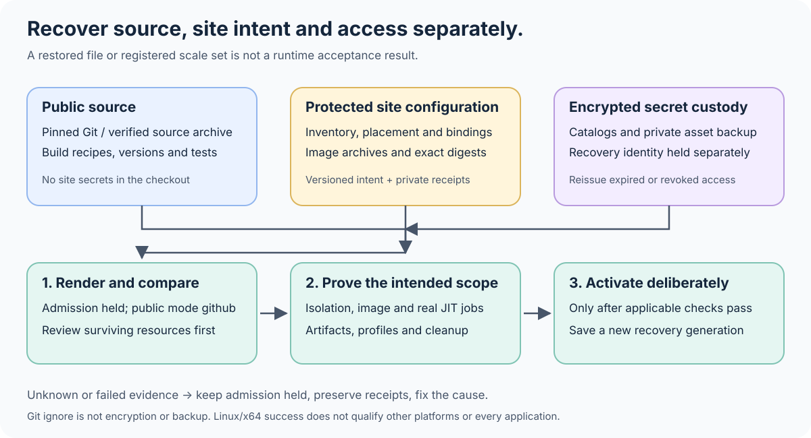

# ARC recovery and reuse

This is the entry point for restoring the runner control plane or preparing it
for another organization. It separates reproducible source from site settings
and recoverable credentials. A successful render or image build is not a working
reserve: public routing stays `github` until the applicable acceptance records
prove otherwise.

## Keep three distinct records

**Public source:** pin the toolkit commit and retain its Git bundle or verified
source release, dependency locks, chart/runtime versions, image build inputs and
this runbook. [The source inventory](../source-files.json) identifies portable
release files; `scripts/toolkit_source.py` is the existing source packager. Do not
create a parallel release format. See [source verification](../scripts/toolkit_source.py)
and the [runtime/image prerequisites](RUNNERS.md#linuxx64-sandbox-deployment).

**Site configuration:** keep actual repository inventories, approved render
arguments, listener and worker placement, group/App IDs and permissions, image
references, guard public configuration, network restrictions and operation
receipts in the existing access-controlled site configuration repository or a
protected recovery root. This metadata can be sensitive. Preserve the original
configuration owner and commit; do not fork a second authoritative live inventory
into a public toolkit checkout. Local scripts that pin installed paths or tool
hashes also need versioned source in that protected repository and a documented
entry point; a transient chat artifact is not sufficient recovery storage.

**Secret material:** keep App PEMs, tokens, node TLS private keys, kubeconfig,
decrypted catalogs and recovery identities outside all source checkouts. Use the
existing [secret control plane](SECRETS.md), [catalog recovery](SECRETS_RECOVERY.md)
and [GitHub publication/binding](SECRETS_GITHUB.md) procedures. Retain encrypted
private asset archives and independently approved checkpoints. Store the recovery
identity separately from the ciphertext. An App's ID or a Kubernetes Secret name
cannot recreate a lost key; GitHub cannot return existing secret values.

Use owner-only directories/files for local site and credential storage (`0700` /
`0600`). The already ignored `operator-config/` area may hold disposable non-secret
render output or a pointer to the protected root. It is **not encryption, a backup
or the canonical site store**. Do not put credentials there, and do not force-add
its contents. Protect and back up the site repository independently of this Mac,
the cluster and GitHub access being restored.

## Freeze one recoverable generation

Start from the [synthetic record template](examples/arc-recovery/generation.example.json).
It deliberately contains no successful acceptance claims. Record:

- Exact public toolkit commit, site-configuration commit and any site-specific
  operator-adapter commit; verify each bundle by restoring to a disposable clone
  and checking its commit/tree. A bundle saves Git source, not ignored files.
- Explicit public and private inventory locations, render arguments and generated
  values hashes, App/group/selected-repository bindings and their observation time.
  Do not save raw Pod environment values or JIT tokens in evidence.
- Pinned chart/runtime versions from [versions.json](../deploy/runner-reserve/versions.json),
  installed runtime configuration/binary hashes, reviewed guard source/configuration
  and public CA fingerprint. Back up the private TLS key through separate custody.
- Worker OCI archive SHA-256, its selected platform **manifest digest**, image
  configuration, source revision, baked bootstrap and public CA hashes. The archive
  checksum, manifest digest and Docker image/config ID are different identifiers.
  Save every still-needed native/ARM image independently as well.
- Encrypted catalog generation/digest, asset checkpoint digests and the separate
  recovery-key custody reference. Record which credentials remain valid; backups
  do not extend expiry or reverse revocation.
- Acceptance evidence with source/image/node/config identities, time, exact scope
  and remaining gaps. Keep `NOT_EVALUATED`, failed and passed outcomes distinct.

Keep older known-working generations until the new one has a verified off-device
restore. A local decryption proves local custody only; a synchronizing folder icon
does not prove that the independent backup can be downloaded and restored.

## Stream large recovery assets within a measured budget

Use [arc_recovery_payload.py](../scripts/arc_recovery_payload.py) for large,
already identified assets such as retained OCI archives. This is an ordinary
USTAR envelope with a parts manifest, not a replacement for the source packager
or the secret catalog. Compression and encryption remain standard `zstd` and
`age`; the helper does not discover credentials, upload files or delete originals.
Interleaving equal-size parts can improve compression for similar archives, but
no compression ratio is guaranteed. Budget the original files, staged parts,
ciphertext, metadata and restore workspace before starting.

Keep the site-specific executor in the protected site repository. It must bind
exact input/tool hashes, arguments, destinations, recipients, free-space reserve
and deadlines. Use an owner-only workspace without concurrent writers. Preparation
and the [pipeline supervisor](../scripts/arc_recovery_pipeline.py) require POSIX;
they do not support Windows execution. The archive itself is portable. Live CPU,
memory, swap and process limits come from a separately reviewed **Linux systemd
unit**, not from the Python supervisor or a successful local test.

1. **Prepare from trusted metadata.** Supply a JSON list containing each original's
   `name`, `path`, `bytes` and `sha256`. Names are unique short identifiers; paths
   remain private. Run `arc_recovery_payload.py prepare --manifest INPUTS.json
   --directory NEW_STAGE --max-bytes ORIGINAL_LIMIT --reserve-bytes FREE_RESERVE`
   inside the bounded unit. The default part size is 128 MiB. The helper verifies
   original hashes, stages numbered parts and writes a canonical `manifest.json`.
   Retain this manifest and its hash independently of the encrypted stream.
2. **Pack, compress, encrypt.** The protected adapter calls
   `arc_recovery_pipeline.run(commands, destination, maximum=..., reserve=...,
   timeout=..., inputs=...)` with separate argv lists for
   `arc_recovery_payload.py pack --manifest NEW_STAGE/manifest.json --directory
   NEW_STAGE --max-bytes ORIGINAL_LIMIT`, `zstd` and `age`. Pin public recipient
   identities; never put private keys or tokens in argv. The `inputs` mapping binds
   each reviewed input path to its `bytes` and `sha256`. The supervisor records
   argv and input paths in private intent metadata, caps output/stderr bytes,
   checks free space while writing, terminates its process groups on failure and
   never retries or overwrites an existing destination. It does not itself select
   safe commands or enforce a network policy.
3. **Require complete acceptance.** Preserve `.partial` and `.pending` files after
   failure. A final ciphertext filename, a pending receipt or `passed: true` copied
   from an earlier attempt is insufficient. Require the matching final receipt,
   its exact ciphertext size/hash, successful overall unit exit and the independent
   restore proof. The supervisor deliberately reports
   `cpu_memory_limits_verified: false`: separately retain the actual unit limits
   and observed result. Unit policy must bound `CPUQuota`, `MemoryMax`,
   `MemorySwapMax`, `TasksMax` and `RuntimeMaxSec`, with `KillMode=control-group`,
   a finite `TimeoutStopSec`, owned writable paths and no unnecessary privileges.
4. **Restore and compare every original.** For each required recovery identity,
   stream `age` decryption through `zstd` decompression into
   `arc_recovery_payload.py verify --manifest TRUSTED_MANIFEST.json --max-bytes
   ORIGINAL_LIMIT` under the same resource controls. Use the external trusted
   manifest, not one accepted merely because it appeared inside the archive.
   Verification rejects links, unexpected members/order, oversized or truncated
   streams and incorrect part/original hashes without extracting files. It checks
   the SHA-256 and byte count of every reassembled original. Record the manifest
   hash, ciphertext hash, tool identities, unit result and verification output.

Manual recovery remains possible with standard tools: decrypt and decompress to
USTAR, inspect the complete member list against the trusted manifest, then extract
only its regular-file members into a new empty directory. Concatenate each
original's numbered parts **in the manifest's order**, then compare its declared
byte count and SHA-256. Do not trust an arbitrary archive for extraction or assume
that tar member order groups all parts of one original together. Keep a tested
manual restore record as well as the streaming verification result.

A local synchronized-folder copy still needs a later independent download and
restore before it counts as an off-device backup. Do not prune old generations,
staging files or originals solely because packing, encryption or upload finished.

## Restore in order, with admission held

1. **Identify what survived.** Compare actual owners, inventories, cluster objects,
   nodes, image content and access bindings with the approved generation. Do not
   reinstall over surviving resources or replace a custom K3s configuration blindly.
   Preserve previous values, resource identities and rollback evidence first.
2. **Recover source and credentials separately.** Restore pinned source and site
   configuration into clean locations. Verify the encrypted generation/checkpoint
   before exposing one needed credential. Recover account/MFA access independently;
   reissue expired or revoked keys through their issuer. Follow the existing custody
   adapter's pinned prerequisites and tests instead of bypassing a hash refusal.
3. **Prepare the node and control plane.** Follow [public deployment](RUNNERS.md#linuxx64-sandbox-deployment)
   or [private provisioning](PRIVATE_EPHEMERAL_RUNNERS.md#provisioning). Reconcile the
   controller identity/RBAC, RuntimeClass, node runtime, guard TLS and network policy.
   Listener placement does not move worker runtime, image or guard requirements.
   Compare physical-host free space and guest logical free space separately before
   copying images; neither is implied by total disk capacity.
4. **Recover or rebuild the image.** Verify a retained OCI archive before importing
   it. Otherwise build the pinned source with its reviewed public CA and dependency
   inputs. Verify `linux/amd64` against the worker RuntimeClass, image user/entrypoint,
   source labels and baked file hashes. Import/readback need not launch a worker.
   For a site archive containing a nested index, use the verified
   [runtime transport](RUNNER_IMAGE_ARTIFACTS.md#prepare-a-runtime-transport-for-containerd)
   and require the imported target to match its runtime manifest digest. Keep
   the full archive, conversion evidence and exact converter tools separately.
   Preserve the new archive and digest; a rebuilt tag need not reproduce old bytes.
5. **Render a held plan.** Use `--held` for public registrations and leave public
   `CI_RUNNER_MODE=github`. The [portable example](examples/arc-recovery/README.md)
   uses explicit `--inventory` and no APIs. For private pools preserve the existing
   reviewed profile/hold policy; their renderer's defaults do not hold every pool.
   Inspect the complete diff, namespaces, quotas, image digest, selected repositories
   and role separation before any installation. Rendering does not authorize apply.
6. **Qualify one isolated scope.** Use the separately reviewed operator procedure.
   Keep the existing isolation boundaries and record actual results. A local image
   probe has a 600-second limit after bootstrap plus 15 seconds for termination;
   it does not prove GitHub JIT, cross-owner reuse or application compatibility.
   A historical timeout, runtime rejection or unrelated device test is not acceptance.
7. **Activate deliberately, then back up again.** Only after all required evidence
   passes, have the configuration owner change the intended admission and routing.
   Reconcile Terraform-managed variables in their source; do not leave hidden drift.
   Start with one selected repository/profile, observe a complete real job and
   cleanup, then expand within measured capacity. Record and protect the new generation.

## Acceptance is scoped, never inferred

Registration, a ready listener and zero idle workers can all coexist normally.
Use [arc_readiness.py](RUNNERS.md#inspect-arc-snapshots-without-changing-routing) on complete,
sanitized snapshots, but do not treat its configuration result as runtime proof.
The required evidence includes:

- Exact repository/organization access and distinct CI, automation and release
  credentials/labels; public and private trust boundaries remain separate.
- Fresh node admission, expected RuntimeClass, blocked private/API/metadata
  destinations, no host sockets or host credential mounts, bounded resources.
- The current image's toolchains, pinned `gh --slurp`, nested Docker build and
  PostgreSQL service behavior, followed by owned Pod/container/fence cleanup.
- A real GitHub JIT job, artifact upload/download and post-job destruction for the
  intended owner/profile; separately prove cross-owner reusable calls where used.
- Applicable application jobs and explicit exclusions. Linux/x64 success does
  not certify ARM, macOS, Windows, fixed-OS matrices, hardware or LAN profiles.

For another site, review `deploy/runner-reserve/network-policy.json` and the
node guard's local `extra_denied` configuration together. Retain the mandatory
non-public/metadata deny baseline and align site-specific extra destinations in
both layers before qualification. The inventory option does not override the
bundled network policy; it can retain a site-specific extra denial. Do not remove
an existing fence merely to make the example work. The public inventory supports
separate organization installations but at most one personal account, because
all personal repository scopes share one installation Secret reference.

A GitHub control-plane incident can delay ARC too. A reserve is not an offline
replacement for GitHub orchestration, logs or artifacts.

## Troubleshooting and rollback

- **No registered GitHub workers:** first distinguish held `maxRunners=0`, idle
  scale-to-zero, missing registration, wrong owner/group/label and incomplete
  inventory. Do not create persistent workers to hide a routing mismatch.
- **Pending Pod:** compare worker selector and RuntimeClass scheduling, available
  node resources/Pod slots, listener capacity, quota and preloaded image digest.
  A different listener node does not fix a missing worker runtime.
- **Admission or TLS failure:** verify guard source/configuration, exact Pod
  identity, CA fingerprint, certificate SAN/expiry and current network fence.
  Do not disable TLS checks or replace isolation with permissive networking.
- **Nested Docker/CLI failure:** compare baked file hashes and source revision,
  inspect bounded bootstrap diagnostics and check the current image. Old tags can
  contain old startup code. Do not assume a new gVisor candidate is required merely
  because a historical worker failed for a different reason.
- **Secret authentication failure:** verify issuer validity, installation/group
  scope and expected Secret binding without printing values. Restore/reissue one
  intended credential through custody; do not give workers a control-plane App key.
- **Queue or status delay:** distinguish no demand, quota wait, local failure and
  GitHub service delay before retrying. Do not blindly rerun publishing jobs.

On failed acceptance, keep public routing `github`, close only the admission you
opened, allow owned jobs to drain and verify owned Pod/registration/fence cleanup.
Restore only the reviewed previous configuration/image if it remains valid.
Do not delete unrelated resources, weaken checks or discard partial-operation
receipts. Hold affected scopes until a new cause-specific fix is reviewed.
