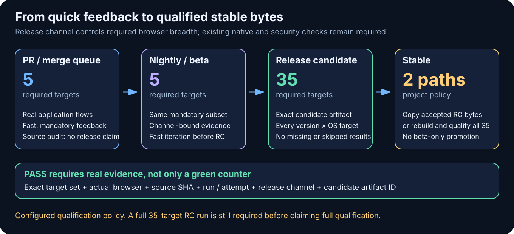
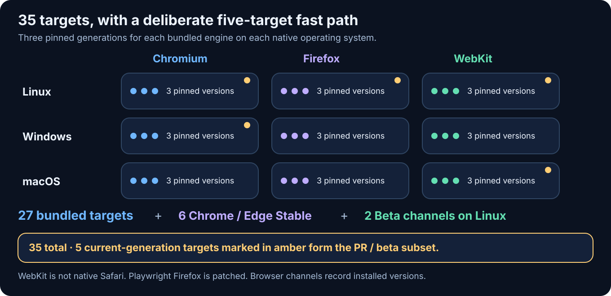
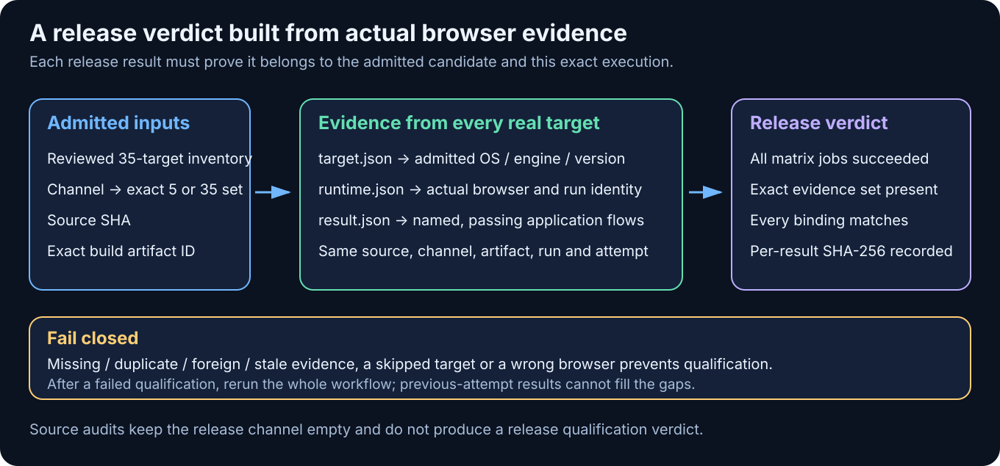

# Browser and operating-system acceptance

The existing `typescript-ci.yml` reusable workflow accepts an **opt-in** browser
inventory. Existing callers retain their current behavior. A successful ordinary
Node test job does not imply that a browser or another operating system was tested.

Use this for applications with a web interface and browser-dependent libraries.
Backend-only services and embedded firmware need their own runtime/platform tests,
not empty browser jobs. Keep native application, installer and hardware checks in
their current adapters.



The diagrams describe the configured qualification policy. They do not certify
that a consumer has passed a complete 35-target run; assess each candidate from
its own completed workflow and evidence. A smaller local or PR run is not a
substitute.

## Prepare a consumer

From a reviewed toolkit checkout, prepare the separate browser toolchain locks:

```bash
python3 scripts/prepare_browser_compatibility.py /path/to/consumer
python3 scripts/prepare_browser_compatibility.py /path/to/consumer --check
```

This writes three standalone npm lock directories and
`.github/browser-compatibility.json`; it does not edit application dependencies,
workflows, runner settings or release policy. Review the generated inventory before
committing. Re-running the generator replaces these owned files; retain intentional
customization separately instead of overwriting a customized inventory.

Historical toolchains must remain separate generations. The shared `renovate-ci`
preset manages CI references, not npm packages. If a consumer enables Renovate's
npm manager, disable updates specifically for `tools/browser-compatibility/**`
and advance this reviewed compatibility window together; ordinary application
dependencies should continue to receive their normal updates.

The starter selects five required targets: current Chromium, Firefox and WebKit on
Linux, Chromium on Windows, and WebKit on macOS. Its extended selection runs all
three pinned Playwright generations across all three operating systems, Chrome and
Edge Stable on each system, and Chrome/Edge Beta on Linux: **35 total targets**.
The locks include npm integrity hashes and the expected bundled browser versions;
the workflow rejects changed versions before running application tests. Browser
binary installation follows Playwright's pinned revision catalog. Branded Stable
and Beta channels follow the vendor's installed current release and record its
actual version; they are not advertised as historically pinned Chrome/Edge builds.

An application may explicitly select `macos-15-intel` instead of `macos-15` for
an individual target when its browser generation needs the Intel environment.
Use a distinct target ID that identifies that runner and keep the engine,
generation, browser pin and tier unchanged. The actual runner remains Intel and
must report `process.arch === 'x64'`; admission treats both runner labels as one
macOS operating-system slot. An ARM and Intel entry for the same engine,
generation and channel cannot replace a missing Linux or Windows target.

Qualify the same application assertions on the selected runner and document the
measured reason in the consumer. This selection does not claim coverage of both
architectures or native Safari. Preserve intentional overrides when reviewing
generated inventory updates: the generator continues to emit the default
`macos-15` matrix, and its `--check` reports customization as drift.



Each cell covers three browser generations. Amber markers identify the current
generation used in the five-target subset. Chrome and Edge channels add eight
targets outside that bundled-engine grid.

Add these inputs to the existing TypeScript reusable call, pinned to the reviewed
toolkit commit as usual:

```yaml
with:
  browser-matrix-file: .github/browser-compatibility.json
  browser-test-command: node scripts/browser-acceptance.cjs
  browser-prepare-command: npm ci --ignore-scripts && npm run build
  browser-extended: ${{ github.event_name == 'schedule' || github.event_name == 'workflow_dispatch' }}
```

When a consumer already has its ordinary Node checks in another required job,
set `run-node-ci: false` for this browser-only call to avoid a redundant install
and lint/build/test job. The default is `true`, preserving existing callers.

Alternatively pass a JSON target array with `browser-matrix`; do not supply both.
The matrix file is relative to the checkout root. Toolchain paths and test commands
are relative to `working-directory`. A monorepo should prepare the lock directories
inside its selected application directory and keep the inventory accessible from
the checkout root.

The caller owns scheduled/manual source audits: leave `browser-release-channel`
empty and select the extended tier explicitly. A release caller must pass its
actual `browser-release-channel`: `nightly` and `beta` require exactly the five
required targets, while `rc` and a freshly built `stable` require all 35. Set
`browser-extended` to true only for `rc`/`stable`; conflicting settings fail before
jobs start. A stable promotion reuses an accepted RC's unchanged artifact and
qualification; it must not substitute a smaller beta run. If ordinary CI is
also the release validator, thread the release channel through that existing
adapter. Merely having an extended inventory does not execute it. Keep the call in
the required Quality gate so a failed selected target blocks that gate. Scheduled
failures must be fixed before promoting a candidate; no target uses
`continue-on-error` and an existing red check is not waived by a smaller rerun.

When browser tests qualify a compiled candidate produced by an earlier job, make
this reusable call depend on that build and pass `browser-artifact-id` from the
build's upload output plus `browser-artifact-path` for its checkout-relative
destination. Both inputs are required together. The workflow downloads that one
exact artifact from the current run before the application preparation command;
it never searches a latest run or an artifact name. Stage and verify the candidate
in the preparation command so the matrix tests the new compiler output rather
than an older committed vendor copy. Existing native or codec-specific candidate
checks remain required alongside this browser matrix. If source CI and packaged
candidate qualification call the workflow within the same run, give the latter
a distinct `browser-evidence-prefix` such as `browser-release` to prevent their
artifact names from colliding. The inventory and assertions can remain identical.

For a compiled release candidate, the caller therefore supplies:

```yaml
with:
  browser-release-channel: ${{ inputs.channel }}
  browser-extended: ${{ inputs.channel == 'rc' || inputs.channel == 'stable' }}
  browser-evidence-prefix: browser-release
  browser-artifact-id: ${{ needs.build.outputs.browser-artifact-id }}
  browser-artifact-path: browser-candidate
```

The release verdict requires successful planning and every selected matrix job.
It downloads the current attempt's evidence and checks the exact target set,
each admitted target definition, actual browser version, successful named
scenarios, source SHA, run ID, run attempt, channel and candidate artifact ID.
The release plan also checks the full three-OS, three-engine, three-generation
cross-product, consistent distinct browser pins, the five current required
targets, and all eight current branded-channel targets. Keeping only the target
count while removing a platform or engine is rejected.
Missing, duplicate, extra or stale evidence fails qualification. Its aggregate
receipt records the verified targets and each result's SHA-256 digest. Source
audits with an empty release channel do not claim release qualification.
Re-run the complete qualification workflow after a failure: results from an older
run attempt are deliberately rejected, even if an individual old target passed.

## Application acceptance contract



The outcome is a verifiable statement about the tested candidate: every expected
target ran the application's actual scenarios, and every result belongs to the
same source, release channel, artifact and workflow attempt. Traces help explain
failures; the verdict cannot replace application assertions.

The consumer must adapt real user-flow tests to the provided toolchain rather than
loading the application's original Playwright in every purported version target:

```javascript
const fs = require('node:fs');
const path = require('node:path');
const playwright = require(process.env.CI_PLAYWRIGHT_MODULE);
const engine = process.env.CI_BROWSER_ENGINE;
const channel = process.env.CI_BROWSER_CHANNEL;
const browser = await playwright[engine].launch({
  headless: true, ...(channel ? {channel} : {}),
});
try {
  // Run existing assertions against synthetic local fixtures. These names must
  // be added only after each actual scenario succeeds; never count skipped tests.
  const scenarios = await runApplicationScenarios(browser);
  const runtime = JSON.parse(fs.readFileSync(
    path.join(process.env.CI_BROWSER_DIAGNOSTICS, 'runtime.json'), 'utf8'));
  fs.writeFileSync(process.env.CI_BROWSER_EVIDENCE, JSON.stringify({
    ...runtime, engine: browser.browserType().name(),
    browserVersion: browser.version(), testsPassed: scenarios.length,
    testsFailed: 0, scenarios,
  }));
} finally {
  await browser.close();
}
```

This excerpt belongs inside an async function. A page-load smoke alone is not a
replacement for application acceptance: exercise navigation, form input and saved
state, reconnect/error paths, or the product's relevant rendering/playback flows.
Keep existing assertions and performance thresholds. Tests may add headed/Xvfb
launching where the application requires it; the default identity probe is
headless and does not itself count as a passing application scenario.

Evidence must match the actual runtime probe, source SHA, run ID, run attempt,
release channel and candidate artifact ID (empty for checkout source tests).
Missing evidence, zero tests, duplicated scenario names, stale attempts, mismatched
browser versions and failed tests fail the job. The adapter clears old result
evidence before invoking the application command. Write screenshots, traces and
logs under `CI_BROWSER_DIAGNOSTICS`; the workflow uploads that target's directory
even on failure. Use synthetic data: artifacts must not include personal accounts,
access tokens, production pages or private fixture contents.

## Public consumer scope

Adoption is based on the application surface, not the repository's primary
language. Track the actual consumer workflow and required gate when reviewing a
rollout; this list is not evidence that every consumer already runs all targets.

- `inverter-dashboard-vue` and `ha-desloc-card`: use application DOM acceptance
  adapters for this matrix. Keep their existing unit, packaging and integration
  checks alongside the browser gate.
- `inverter-dashboard` and `inverter-dashboard-go`: the Python static dashboard
  and Go embedded HTML/Vue interface also need real browser acceptance. Their
  existing Python/Go tests alone do not cover these interfaces.
- `inverter-desktop`: qualify its Vue interface with a controlled Tauri IPC
  fixture; retain separate native Tauri, Rust and installer checks. Browser
  emulation cannot replace those platform checks.
- `inverter-web-vitrine`: exercise its committed status page against synthetic
  same-origin health/snapshot responses, including polling, failure recovery,
  out-of-order replies and mobile layout. This remains validation-only.
- `ottplay-core`: adapt its existing CJS browser scenarios to the selected
  isolated module and engine, retaining their real playback and UI assertions.
- `ottplay-foss`: retain its specialized Playwright Test and media fixtures.
  Its test runner and selected browser must use the same reviewed generation;
  changing only an environment variable does not migrate a hardcoded runner.
  Keep native media, codec and device qualification separate.
- `home-studio`: retain its dedicated current/historical browser and native
  Safari/Firefox qualification. Consolidate only where a shared adapter
  preserves the stronger existing assertions and platform coverage.
- `ha-access-session`: include `gateway/web/index.html` in the owning
  application's browser acceptance; Python protocol tests do not qualify the
  gateway's login interface.
- `ottplay-control-server`: its backend has no browser interface. Keep its Go
  operating-system matrix; do not add an empty browser suite.

## Coverage boundaries and runners

Playwright Firefox is its patched engine build. Native Firefox Stable/ESR and
Waterfox need separate product-specific native adapters. Playwright WebKit is not
Safari: test actual Safari with SafariDriver on macOS where Safari is supported.
Mobile viewport/touch emulation is not testing iOS/Android devices. Media codecs,
DRM, GPU drivers, assistive technology and embedded webviews also require their
native acceptance paths. Preserve such checks when adopting the shared matrix.

Hosted Windows WebKit rows also run `install-deps chromium` through the exact
locked Playwright CLI before installing WebKit. This installs the Windows Server
Media Foundation dependency without downloading Chromium or changing the
selected browser. Playwright's Windows dependency installer currently enables
this feature only for its Chromium group; `install --with-deps webkit` alone
does not prepare video playback. Installer failures fail the job, and the
application's actual decoded-playback assertions remain required. This setup
does not claim support for DRM or additional media codecs.

GitHub-hosted systems remain the default. Only `ubuntu-latest` targets may select
the existing, opt-in, isolated Linux reserve via `CI_RUNNER_MODE`. The planner
uses that same reserve policy. Forks and untrusted events stay hosted. Fixed
Ubuntu, macOS and Windows targets retain their explicit hosted systems; they do
not collapse onto a Linux worker during an outage. Dedicated non-Linux reserves
need their own admission evidence before routing can be extended. No switch or
runner registration is changed by this feature. Reserve images must already
contain system libraries and any requested branded Chrome/Edge channels. Jobs
only download bundled engines on the reserve; they do not run branded browser
installers or system package installation there. An unavailable preinstalled
channel fails its runtime probe rather than silently changing browser coverage.

The planner has a 15-minute job budget, including checkout and Node 22 setup.
This allows a newly created reserve runner to populate its tool cache on a slow
connection; a cold setup has taken about eight minutes before planning could
start. Warm-cache runs finish sooner, but a replaced runner may need that setup
again. Browser target jobs retain their separate 25-minute budget, and the
release verdict retains five minutes. Application test timeouts are unchanged.

References: [Playwright browser and branded-channel differences](https://playwright.dev/docs/browsers),
[CI platform setup](https://playwright.dev/docs/ci), and
[Safari WebDriver](https://developer.apple.com/documentation/webkit/testing-with-webdriver-in-safari).
The Windows prerequisite is implemented by
[Playwright's dependency installer](https://github.com/microsoft/playwright/blob/main/packages/playwright-core/src/server/registry/dependencies.ts).
