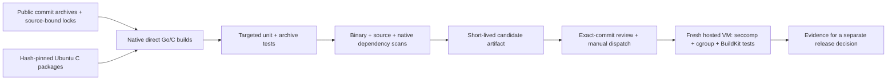

# Source-built OCI tool qualification

This lane builds candidate **BuildKit 0.34.1 and runc 1.5.2** from pinned public
upstream source, with Go 1.27.3 and reviewed module updates. It does not use Docker,
Buildx or an existing BuildKit daemon to bootstrap either tool. It does not change
the toolkit release policy, publish a production binary, install a household
service or include private application sources.

**Status:** implementation under review. Neither compilation nor runtime success
is implied by this document. Use the exact workflow run and its evidence to assess
a candidate. A passing source job alone does not qualify its runtime behavior.

## Inputs and stages

The source of truth is [sources.json](../.github/oci-tools/sources.json), its
source-bound go.mod/go.sum/module graphs, and architecture-specific native locks.
The original upstream lock hashes and the regenerated vendor-tree hash bind the
module changes to a particular archive. CI rejects drift rather than refreshing
the locks automatically.



The two native targets are `ubuntu-24.04`/amd64 and `ubuntu-24.04-arm`/arm64.
Neither job falls back to shared or household runners. Compilation and unit tests
run without root. Native package installation is the only sudo operation in the
source job. Packages come from the 2026-11-03 Ubuntu snapshot, with individually
pinned versions, download sizes and SHA-256 digests. The compiler, libc, binutils,
Linux headers and libseccomp dependency closure are explicit. Installation permits
no missing-package download or package removal; a host incompatibility must be
resolved in the recipe rather than silently accepted.

runc uses CGO and static external linking. The tags match the pinned BuildKit
Dockerfile's runc build (`apparmor seccomp netgo cgo static_build osusergo`), rather
than the separate runc Makefile defaults that add libpathrs. **Seccomp remains
enabled.** This uses Ubuntu/glibc, not the upstream Dockerfile's Alpine/musl; it is
not a bit-for-bit reproduction of the upstream binary. ELF inspection rejects
dynamic dependencies. The downstream version is marked `victron.security.1`.

RootlessKit, CNI, QEMU, external Dockerfile frontends and containerd are outside this
first rootful OCI-worker qualification. None is downloaded implicitly to make a
test pass.

## What the checks establish

- Source archives pass the existing bounded, path-safe extraction checks. Module
  resolution must equal the reviewed full graph, and regenerated vendor bytes must
  match the reviewed hash. The Go toolchain may not download a replacement.
- Targeted upstream tests cover BuildKit file operations, Dockerfile parsing and
  signature utilities; runc specification conversion, configuration and capability
  handling. These are not the complete upstream integration suites.
- Additional archive tests exercise normal file/symlink/hardlink extraction and
  attempted parent, symlink and hardlink escapes while monitoring an outside
  sentinel. A safely confined path is acceptable; an outside write is not.
- Source and binary `govulncheck` reports, full Trivy binary/native-package reports,
  package inventories and CycloneDX SBOMs are retained. Trivy must inventory all
  four executable artifacts; an empty or partial scan cannot pass. Unfixed high
  and critical findings are still failures. Scanner identities and database
  metadata accompany the reports.
- `GO-2026-5932` affects the old `golang.org/x/crypto/openpgp` package. The maintained
  ProtonMail package is distinct. Production/test package graphs and exact binary
  analysis distinguish these; module presence alone is not evidence that the old
  package is executed. There is currently **no automatic vulnerability exemption**.
  Any finding must be assessed against the actual binary before a narrow,
  evidence-backed disposition is reviewed. See the [Go advisory](https://pkg.go.dev/vuln/GO-2026-5932).
- All candidates retain upstream, Go, used module and native-package license or
  copyright notices. This is an internal CI artifact, not a production release.

The privileged stage starts from fresh disposable hosted workers. It verifies the
source commit, architecture, input manifest and binary hashes against the passing
source/security stage. A baseline container must execute the same static probe
that the restricted container uses. The latter must see `EPERM` for `getppid`
(seccomp), must be denied `/dev/zero` (cgroup v2 device filter), and must still open
the explicitly permitted `/dev/null`. Missing cgroup v2 is a failure, not a skip.

The candidate BuildKit then uses its explicitly named candidate runc, an isolated
root/socket, native snapshotter and disabled containerd worker. A scratch image
exercises ADD extraction, links, a real RUN instruction and local export, without
pulling an image or a frontend. Another ADD attempts a host-side traversal while
an outside sentinel is checked. Results and exit codes are recorded honestly:
safe confinement and rejection are distinguished, and no blanket claim about
all upstream security tests is made.

## Running the lane

Pull requests touching this lane run source/unit/security qualification only.
When `locks_reviewed` is false, they instead run only nonprivileged dependency
preparation on a hosted worker and upload `oci-prepared-locks`. No native packages
are installed and no candidate is compiled or executed in that state. Review the
generated full graph, vendor hash and lock diff, then commit them with
`locks_reviewed=true` to admit source qualification. Preparation never changes
that flag itself. This also avoids large dependency caches on a developer's Mac.
Local lightweight contract checks are:

```sh
python3 scripts/build_oci_tools.py validate
python3 -m unittest discover -s tests -p test_oci_tools.py -v
```

After review of the recipe, source locks and the source-stage results, a maintainer
may dispatch `oci-tool-qualification.yml` on that exact branch/commit, with
`qualify_runtime=true` and `reviewed_commit` set to the full 40-character commit.
The workflow and Python gate both reject a different commit or event. No scheduled
or pull-request event enables privileged candidate execution. The source and
security checks rerun before the privileged jobs; an earlier success is not
substituted for the dispatched commit.

Candidate tarballs expire after seven days; evidence expires after fourteen.
Download necessary review evidence before expiry. Both successful and failed
source jobs upload the available reports. No publication permission or registry
credential is requested by this workflow.

## Updating inputs and diagnosing failures

Prepare changes in a disposable source directory, outside primary repositories:
verify the exact commit archive, record original locks, apply the explicitly
selected module versions with Go 1.27.3, then run `go mod tidy`, `go mod verify`,
`go mod vendor` and `go list -mod=readonly -m -json all`. The recipe's
`locked_modules()` removes machine paths, and `tree_digest()` binds vendor paths
and file contents independently of timestamps. Review the complete lock diff and
regenerate `inputs.json` source bindings. Do not copy only the top-level version
numbers while retaining an older vendor tree.

- **Dependency/API failures:** inspect the native build log; never remove seccomp,
  change tags or bypass test packages simply to obtain a green result.
- **Native install mismatch:** review the new hosted image and the entire locked
  package closure. No apt fallback or implicit upgrade is allowed.
- **Security failure:** inspect full per-binary/per-package reports, module graph,
  exact ELF build information and scanner/database identity. A module-level alert
  is not permission to suppress its packages globally.
- **Runtime failure:** compare the baseline and restricted probes, kernel identity
  and BuildKit log. No system daemon or global network policy needs changing.
- **Missing evidence or drift:** rerun the reviewed source lane. Do not reuse a
  binary whose source, architecture or SHA-256 does not match.

Production packaging, signed release publication, a rootless configuration,
application builds and household rollout each require their own reviewed scope.
