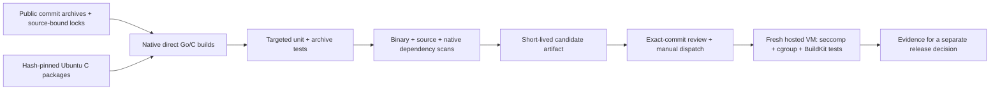

# Source-built OCI tool qualification

This lane builds candidate **BuildKit 0.34.1 and runc 1.5.2** from pinned public
upstream source, with Go 1.27.3 and reviewed module updates. It does not use Docker,
Buildx or an existing BuildKit daemon to bootstrap either tool. It does not change
the toolkit release policy, publish a production binary, install a household
service or include private application sources.

**Status:** implementation under review. At source `86de20e`, both native targets
compiled, targeted tests passed, and source/binary Go scans were clean. The native
package gate remained blocked by 385 findings on the exact Linux header package.
The finite applicability guard below has been reviewed. Fresh hosted validation
must still pass the strict installed-file and security gates. No privileged runtime
qualification has run. Use the exact workflow run and its evidence to assess a
candidate; source validation alone does not qualify runtime behavior.

## Inputs and stages

The source of truth is [sources.json](../.github/oci-tools/sources.json), its
source-bound go.mod/go.sum/module graphs, and architecture-specific native locks.
The original upstream lock hashes and the regenerated vendor-tree hash bind the
module changes to a particular archive. CI rejects drift rather than refreshing
the locks automatically.



The two native targets are `ubuntu-24.04`/amd64 and `ubuntu-24.04-arm`/arm64.
Neither job falls back to shared or household runners. Compilation and unit tests
run without root. Native package installation and the finite metadata repair
described below are the only sudo operations in the source job. Packages come
from the 2026-11-03 Ubuntu snapshot, with individually
pinned versions, download sizes and SHA-256 digests. The compiler, libc, binutils,
Linux headers and libseccomp dependency closure are explicit. Installation permits
no missing-package download or package removal; a host incompatibility must be
resolved in the recipe rather than silently accepted.
Verified `.deb` files are staged under canonical apt cache names in an isolated
archive directory. This lets `--no-download` install the reviewed files without
consulting the host's shared archive cache.

runc uses CGO and static external linking. The tags match the pinned BuildKit
Dockerfile's runc build (`apparmor seccomp netgo cgo static_build osusergo`), rather
than the separate runc Makefile defaults that add libpathrs. **Seccomp remains
enabled.** This uses Ubuntu/glibc, not the upstream Dockerfile's Alpine/musl; it is
not a bit-for-bit reproduction of the upstream binary. ELF inspection rejects
dynamic dependencies. The downstream version is marked `victron.security.1`.

RootlessKit, CNI, QEMU, external Dockerfile frontends and containerd are outside this
first rootful OCI-worker qualification. None is downloaded implicitly to make a
test pass.

## What the checks establish

- Source archives pass the existing bounded, path-safe extraction checks. Module
  resolution must equal the reviewed full graph, and regenerated vendor bytes must
  match the reviewed hash. The Go toolchain may not download a replacement.
- Targeted upstream tests cover BuildKit file operations, Dockerfile parsing and
  signature utilities; runc specification conversion, configuration and capability
  handling. These are not the complete upstream integration suites.
- Additional archive tests exercise normal file/symlink/hardlink extraction and
  attempted parent, symlink and hardlink escapes while monitoring an outside
  sentinel. A safely confined path is acceptable; an outside write is not.
- Source and binary `govulncheck` reports, full Trivy binary/native-package reports,
  package inventories and CycloneDX SBOMs are retained. Trivy must inventory all
  four executable artifacts; an empty or partial scan cannot pass. Unfixed high
  and critical findings are still failures. Scanner identities and database
  metadata accompany the reports.
- JSON-mode `govulncheck` may exit successfully after reporting vulnerabilities.
  The gate parses its complete v1.0.0 stream, verifies the source/binary mode,
  symbol scan level and SBOM target, and assesses findings explicitly. Source
  SBOM roots identify packages; binary SBOM roots identify the main module, as
  defined by the pinned scanner. Exact binary paths, hashes and build information
  are separately retained so that the two BuildKit commands remain distinguishable.
  Source
  call traces and binary symbol presence fail as affected; module/package-only
  findings remain pending review. Missing inventory, malformed evidence and
  interrupted scans fail closed. A bare config message is not a clean scan.
- `GO-2026-5932` affects the old `golang.org/x/crypto/openpgp` package. The maintained
  ProtonMail package is distinct. Production/test package graphs and exact binary
  analysis distinguish these; module presence alone is not evidence that the old
  package is executed. BuildKit pins upstream's exact
  `v0.58.1-0.20261009181718-2f1f834330b2` fix: the immediate child of `v0.58.0`
  moves deprecated OpenPGP into a separate module without changing the maintained
  cryptographic implementations. Full-module resolution still lists the separate
  deprecated module as an indirect input; `openpgp-module-why.txt` records why.
  It must remain absent from the actual target package closures and clean
  source/binary scans. There is **no automatic vulnerability exemption**.
  Any finding must be assessed against the actual binary before a narrow,
  evidence-backed disposition is reviewed. See the [Go advisory](https://pkg.go.dev/vuln/GO-2026-5932).
- All candidates retain upstream, Go, used module and native-package license or
  copyright notices. This is an internal CI artifact, not a production release.

The privileged stage starts from fresh disposable hosted workers. It verifies the
source commit, architecture, input manifest and binary hashes against the passing
source/security stage. A baseline container must execute the same static probe
that the restricted container uses. The latter must see `EPERM` for `getppid`
(seccomp), must be denied `/dev/zero` (cgroup v2 device filter), and must still
open `/dev/null`. Both specifications explicitly declare the same `/dev/zero`
node (1:5): pinned runc's `createDevices` then removes that device's implicit
allow rule, leaving the explicit baseline/restricted policies in control.
The unrestricted baseline must successfully open that exact node before its
denial counts. Missing cgroup v2 is a failure, not a skip.

The candidate BuildKit then uses its explicitly named candidate runc, an isolated
root/socket, native snapshotter and disabled containerd worker. A scratch image
exercises ADD extraction, links, a real RUN instruction and local export, without
pulling an image or a frontend. Another ADD attempts a host-side traversal while
an outside sentinel is checked, using 64 parent components to exceed the native
snapshot directory depth. The bounded, no-follow sentinel observation is saved on failure and timeout;
a timeout remains fatal even if writing evidence also fails.
Results and exit codes are recorded honestly:
safe confinement and rejection are distinguished, and no blanket claim about
all upstream security tests is made.

## Running the lane

### Finite Linux header applicability

The [reviewed policy](../.github/oci-tools/header-disposition.json) binds a finite
set of 385 observed CVEs to Ubuntu 24.04 `linux-libc-dev` version `6.8.0-147.147`,
with separate amd64/arm64 archive hashes, sizes, complete member inventories and
installed-file hashes. It is **inactive while `reviewed` is false**. It is not a
package-wide suppression or a claim that header files cannot contain vulnerable
inline code: for example, exported `linux/swab.h` contains inline operations.

The [per-ID evidence](../.github/oci-tools/header-cve-evidence.json) records official
Linux CNA source URLs, response hashes, affected paths and kernel fix references
for every observed ID. The determination rests on those specific vulnerable
implementations being absent from this userspace component. It relies on the
published affected-component metadata and reviewed patches; it is not a new audit
of all kernel code. The older [Canonical explanation](https://lists.ubuntu.com/archives/kernel-team/2024-February/148886.html)
provides context, not the verdict for newer CVEs.

One case, `CVE-2026-80668`, does touch an exported UAPI path. Its
[upstream patch](https://github.com/torvalds/linux/commit/b8b09dc2bf35a00d4e0556b5d6308c7b917ebda2)
and [stable patch](https://github.com/gregkh/linux/commit/61ca26e1a45965590f7e477c4d6f711162642e1c)
add `NF_CT_EXPECT_DEAD` inside an existing `__KERNEL__` branch, alongside the actual
kernel timer/refcount/garbage-collection fix. The exported 4,588-byte header in
both locked packages has SHA-256
`f96c03a170825a42f0a417efe70d77f05dd4265d7855eb05ba8024a58cc938f8`;
it contains neither that branch marker nor that kernel-only flag. Both archive
and installed-byte checks verify this boundary. They do not infer that C headers
were unused by runc. The normal verbose build command and Go dependency evidence
retain the CGO input names/flags; libc, libseccomp and compiler inputs still have
their own full security checks.

Before installation, the inspector verifies the locked deb hash/size and records
all ar members, tar types, modes, owners, links, directories and control files.
These packages contain only `control`/`md5sums` metadata, no maintainer scripts,
and 990/962 regular data files with 53 directories per architecture. Any link,
special member, duplicate/non-normal path, executable payload or unexpected
control file fails. After installation, the complete `dpkg-query -L` membership,
file UID/GID, permissions, sizes and SHA-256 values must match. Every inventoried
directory, including the installation root, must also match its expected UID/GID
and mode. Component-wise no-follow
opens reject substituted parent directories and final symlinks.

The tested hosted images supplied five package-related paths with mode `0777`:
`/usr/share`, `/usr/share/doc`, `/usr/share/doc/linux-libc-dev`, and that package's
`changelog.Debian.gz` and `copyright`. The source lane restores only these exact
paths to their archived modes (`0755` directories, `0644` files), top-down, before
full installed-file verification. It requires the exact expected owners, types,
and either the documented starting mode or already-correct mode. The two notice
files must each have exactly one hard link and match their archived bytes.
It opens each path without following
symlinks, checks and changes the same descriptor with `fchmod`, and logs every
action including partial progress on failure. There is no recursive repair,
ownership change, or permission exception in the final verification.

After explicit policy review, each matching finding can receive a separate
`not_affected` assessment. Raw Trivy JSON, severity counts and CycloneDX inputs
remain intact. Unknown CVEs, package/version/source/architecture drift, changed
bytes, missing receipts, and HIGH/CRITICAL findings on other native packages or
on binaries remain blocking. The exact package inventory must be in the finding's
own `os-pkgs` result with `Type: ubuntu`; an inventory in a different result cannot
authorize the disposition. A failed security gate cannot produce a candidate
bundle. The native dependency scan does not assess or clear the booted host
kernel; runtime and host-kernel review remain separate.

To reproduce an archive check without installing it, obtain the exact deb URL
from `native-<arch>.json`, verify its size/SHA-256, and call
`oci_header_disposition.inspect_deb(path, package)` with that lock entry.
Compare both returned inventories to `linux-libc-dev-archive-<arch>.json` and
`linux-libc-dev-files-<arch>.json`. On the disposable hosted worker, the normal
`native` action additionally performs the installed-file verification and saves
both receipts. Refreshing a public CNA URL may return revised content: a hash
change requires explicit review, never an automatic extension of this policy.

### Source and runtime execution

Pull requests touching this lane run source/unit/security qualification only.
When `locks_reviewed` is false, they instead run only nonprivileged dependency
preparation on a hosted worker and upload `oci-prepared-locks`. No native packages
are installed and no candidate is compiled or executed in that state. Review the
generated full graph, vendor hash and lock diff, then commit them with
`locks_reviewed=true` to admit source qualification. Preparation never changes
that flag itself. This also avoids large dependency caches on a developer's Mac.
Local lightweight contract checks are:

```sh
python3 scripts/build_oci_tools.py validate
python3 -m unittest discover -s tests -p test_oci_tools.py -v
```

After review of the recipe, source locks and the source-stage results, a maintainer
may dispatch `oci-tool-qualification.yml` on that exact branch/commit, with
`qualify_runtime=true` and `reviewed_commit` set to the full 40-character commit.
The workflow and Python gate both reject a different commit or event. No scheduled
or pull-request event enables privileged candidate execution. The source and
security checks rerun before the privileged jobs; an earlier success is not
substituted for the dispatched commit.

For the initial rollout, a new workflow may need to be merged onto the default
branch before manual dispatch is available. GitHub's
[manual execution documentation](https://docs.github.com/en/actions/how-tos/manage-workflow-runs/manually-run-a-workflow)
requires default-branch presence. A successful source-only bootstrap merge is
not runtime acceptance: privileged execution stays disabled by default. Review
the resulting full merged commit, then authorize and dispatch that exact commit;
the fresh source/security and candidate-hash checks still apply. Do not weaken
the event, commit or artifact gates to work around workflow registration.

Candidate tarballs expire after seven days; evidence expires after fourteen.
Download necessary review evidence before expiry. Both successful and failed
source jobs upload the available reports. No publication permission or registry
credential is requested by this workflow.

## Updating inputs and diagnosing failures

Prepare changes in a disposable source directory, outside primary repositories:
verify the exact commit archive, record original locks, apply the explicitly
selected module versions with Go 1.27.3, then run `go mod tidy`, `go mod verify`,
`go mod vendor` and `go list -mod=readonly -m -json all`. The recipe's
`locked_modules()` removes machine paths, and `tree_digest()` binds vendor paths
and file contents independently of timestamps. Review the complete lock diff and
regenerate `inputs.json` source bindings. Do not copy only the top-level version
numbers while retaining an older vendor tree.

- **Dependency/API failures:** inspect the native build log; never remove seccomp,
  change tags or bypass test packages simply to obtain a green result.
- **Native install mismatch:** review the new hosted image and the entire locked
  package closure. No apt fallback or implicit upgrade is allowed. If apt reports
  missing archives despite successful downloads, check the isolated archive path
  and epoch-encoded filenames; passing local `.deb` paths alone does not satisfy
  `--no-download`.
- **Security failure:** inspect full per-binary/per-package reports, module graph,
  exact ELF build information and scanner/database identity. A module-level alert
  is not permission to suppress its packages globally.
- **Runtime failure:** compare the baseline and restricted probes, kernel identity
  and BuildKit log. No system daemon or global network policy needs changing.
- **Missing evidence or drift:** rerun the reviewed source lane. Do not reuse a
  binary whose source, architecture or SHA-256 does not match.

Production packaging, signed release publication, a rootless configuration,
application builds and household rollout each require their own reviewed scope.
