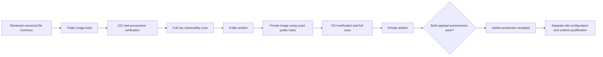

# Hosted runner image artifacts

`runner-image-artifacts.yml` builds the canonical Linux amd64 public runner and
private-mode derivative on two sequential, disposable GitHub-hosted workers.
It produces downloadable OCI archives and evidence, without publishing an image
or changing runner routing. The workflow builds the reviewed canonical
Dockerfiles without rewriting them.

**These artifacts cannot be deployed.** The guard CA is exactly the invalid text
`UNCONFIGURED SITE CA` followed by a newline. The workflow has no site certificate,
private key, registry credential or runner registration token. Its artifacts are
visible to readers of this public repository, so private configuration must never
be added to the workflow or its context inventory.



## Run and inspect

Use **Actions → Build nondeployable runner image artifacts → Run workflow** on
the default branch. Dispatches from other branches, private repositories,
self-hosted workers or non-amd64 workers are rejected. Runs are serialized and
never automatically cancel an earlier run.

The two artifact names include the exact run ID and attempt:

- `runner-image-public-<run-id>-<attempt>`
- `runner-image-private-<run-id>-<attempt>`

Each complete artifact contains `image.oci.tar`, `build-receipt.json`,
`oci-verification.json`, `cgroup-verification.json`, `scan-input.json`, `scan.json`,
`scan-summary.json`, `scan-database.json`, `scan-file-evidence.json`,
`scan-acceptance.json`, the command log, disk observations and `cgroup-observations.jsonl`.
Failure artifacts retain whichever evidence and partial output exists; a partial
archive is never accepted as an image. Artifacts expire after seven days. Copy
accepted archives and their complete evidence to the approved recovery storage
before expiry; the workflow does not perform that backup.

`build_success`, `oci_verified`, `scan_completed`, `scan_gate_passed` and `scan_acceptance_passed` are
separate fields. A raw HIGH/CRITICAL finding does not erase successful build
evidence or block production of the private-mode image. After both artifacts are
uploaded, the final step requires both independently computed payload assessments
to pass. All severities and package records remain in the raw report, and
`scan_gate_passed` continues to mean zero raw HIGH/CRITICAL findings. It may be
false while the separate assessment passes. An unknown or changed finding,
changed effective files, or missing backport proof fails acceptance.

The versioned [applicability review](RUNNER_SCAN_APPLICABILITY.json) enumerates
each permitted advisory, its affected operation, official source references and
required component evidence. The hashed build helper embeds the policy and
binds that review's hash; it reads no external ignore policy. No Trivy ignore or
severity filter is introduced. See the [security contract](RUNNER_IMAGE_SECURITY.md#payload-bound-scan-acceptance).

## Source and artifact contract

`.github/containers/runner-artifacts.json` pins the canonical source, exact
context file SHA256 hashes, sizes and Git modes, plus immutable official BuildKit
and Trivy images. Build contexts are copied from committed Git blobs, not the
working tree or ignored files. Their contents must exactly match the canonical
inventory and each Dockerfile's deny-by-default `.dockerignore`. The invalid CA
is the only separately generated context file.

The image revision label is the actual dispatched `source_commit`. This can be
a later workflow/documentation commit, but every canonical build input must
still match the reviewed inventory. Updating a canonical input requires an
explicit manifest update and review; a changed recipe is never accepted by
merely changing the revision label.

Changing the Go builder identity or directory provisioning changes a canonical
build input and requires refreshed inventory hashes. Source-CI success alone
does not qualify this change; retain an actual nonroot image-build result as
described in the [source-build unit-stage contract](RUNNER_IMAGE_SECURITY.md#nonroot-source-build-unit-stage).
Until that build and subsequent image, scan and runtime gates complete, the
change remains a candidate. Publication or merge does not mean a runner has
been redeployed.

The private job downloads only this run's public artifact and verifies its
source, run, attempt, manifest, context, complete OCI graph, scan and cleanup
evidence. It builds against that exact OCI index via a named context. The private
image must retain the public layer/diff-ID prefix and runtime configuration
apart from stage labels. All descriptors, compressed and uncompressed layer
hashes, the invalid effective CA and the build-provenance subject are checked.
This is integrity evidence, not a signed attestation or a runtime acceptance.

### Attestation formats and verification failures

The offline OCI reader distinguishes executable image configuration from
attestation metadata. A runtime image must use the ordinary OCI image config
and satisfy the runner identity, environment and layer contracts above.

For attestations, the reader supports the legacy image-config form with an
`unknown/unknown` configuration and the OCI-artifact form documented by the
[pinned BuildKit v0.34.1](https://github.com/moby/buildkit/blob/v0.34.1/docs/attestations/attestation-storage.md).
The latter uses `application/vnd.docker.attestation.manifest.v1+json` as its
artifact type and `application/vnd.oci.empty.v1+json` as its config type. The
empty config must be the two bytes `{}`, with their exact size and SHA-256;
optional inline `data` must agree. The local config blob is still required and
verified. The outer descriptor must use the `unknown/unknown` platform. Its
reference annotation and the artifact's subject must point to the single
accepted runtime manifest; the subject must match that manifest's digest, size
and media type.

An empty config is never accepted as runtime configuration. Unknown config types
or attestation artifact types, inconsistent references, missing blobs and invalid
inline data fail verification. Existing archive, layer, provenance and site-CA
checks still apply to both supported attestation forms.

If a run records `build_success: true` but fails before `oci_verified`, inspect
the descriptor named by the verification error and compare it with the pinned
exporter's format. Preserve the archive and failure evidence. A successful
export alone does not establish OCI acceptance or completion of the vulnerability
scan; do not bypass descriptor validation or disable provenance to continue.

### Scanner input

Trivy 0.74.0 accepts a Docker archive or an OCI directory; it does not open an
OCI tar as a directory. The hosted scanner therefore receives a temporary OCI
directory containing the already verified linux/amd64 runtime manifest, its
config and every runtime layer. These blobs retain their exact original bytes.
Its new root index selects that one manifest explicitly, so attestation order
cannot change the image scanned. The complete original archive and provenance
remain in the published artifact; this projection is only the scanner input.

`scan-input.json` binds the original archive and index to the selected descriptors
and every copied file's size and SHA256. All copied files and the original archive
are checked again after the scanner exits, before accepting its output. The raw
report must still contain both OS and language inventories and the exact config
digest. The parent-stage and final gates recheck the input receipt. No raw findings
are removed. A scanner error preserves its command log and partial evidence,
and cannot become a successful scan or release qualification.

## Capacity and ownership

GitHub documents 14 GB of SSD for standard hosted workers; actual free space is
measured before using it. This workflow requires 10 GiB free to start each stage,
keeps a 2 GiB reserve on the workspace, temporary, Docker and containerd
filesystems, and checks it during commands and after successful command exits.
Scanner input projection and private OCI materialization additionally reserve
space for the archive size;
its downloaded tar is removed only after complete validation and materialization.
If a particular hosted image cannot fit, the run stops and retains evidence.
It does not delete preinstalled SDKs, unrelated images or other jobs' caches.

Each owned BuildKit container has two CPUs, 4 GiB RAM, no swap allowance beyond
RAM, no restart policy and one parallel build vertex. The workflow verifies the
actual cgroup v2 limits and private cgroup namespace. It correlates the stable
host daemon PID with `/proc/1/cgroup` inside that container and requires the
resulting root to name that exact Docker container ID. The pinned BuildKit
[relocates its daemon into an `init` child](https://github.com/moby/buildkit/blob/v0.34.1/executor/resources/monitor.go#L236-L274);
unlimited leaf values inherit the bounded Docker root and are retained separately.
The workflow does not search for an arbitrary ancestor with convenient limits.
It then performs a small
20-second RUN using the canonical pinned Ubuntu base. A host-side observer must
see that real RUN process inside the same bound root (it may be a sibling of
the daemon leaf). Root and leaf observations are saved before limit validation,
including failed samples. Limits and builder
identity are rechecked during the canonical build. HostConfig alone is not
accepted as enforcement proof. Each canonical build has a 45-minute deadline;
the scan has a separate bounded command and container. There is no retry loop.

Before the full public build, the same bounded builder executes the canonical
`patched-libbpf` stage with a 15-minute limit and cache-only output. This checks
the package build, ABI and ordinary userspace probe early. Its exact command and
completion are recorded. The subsequent full build may reuse that stage's cache;
this is not a claim that the package was compiled twice. An actual successful
stage is required; source tests alone do not establish a rebuilt library.

Cleanup identifies the exact owned container before removing its immutable ID.
It still works after an OOM or low-disk failure. An ambiguous Docker response is
not treated as absence; removal requires a final absence readback. The scanner
receives only a read-only runtime OCI directory, writable cache and output directories, with
all capabilities dropped and no Docker socket. Cleanup never uses global prune.
The BuildKit state volume is checked absent before creation and bound to the
owned container's `/var/lib/buildkit` mount. Its removal is independently
verified even if Buildx leaves an inactive instance's cache behind. Volume
removal is not forced, so another container's reference prevents deletion.

## After artifact production

An operator must separately review the full scan, configure a site-specific
derivative, preserve its parent/child provenance correctly, run both actual
bootstrap profiles and qualify representative cold/warm jobs with memory and
disk evidence. A site derivative may replace only the invalid CA under its
separately reviewed contract. It must not copy the parent's attestation as though
it attested the new child digest. Neither the hosted workflow nor a successful
scan proves gVisor compatibility, physical deployment, or a suitable CI memory
limit. See [runner image security](RUNNER_IMAGE_SECURITY.md).

### Produce and verify a CA-only site derivative

`scripts/runner_image_site.py` creates a deterministic child OCI archive from an
accepted hosted parent. It verifies the complete parent archive, descriptors,
compressed and uncompressed layer hashes, source identity, runtime configuration
and invalid CA before copying any parent layer. It appends one regular file at
`/opt/victron-ci-reserve/guard-ca.crt`, with mode `0644`, UID/GID `0`, and timestamp
`0`. The child retains every parent layer and the complete runtime configuration.
Only the root filesystem history and the appended CA layer change.

The bootstrap uses `curl --cacert /opt/victron-ci-reserve/guard-ca.crt` explicitly
for the node-guard TLS request. It does not use the system trust store for that
request, so this conversion neither runs `update-ca-certificates` nor changes
other programs' trust configuration. Keep the existing guard address and node
binding in the private operator configuration; neither belongs in this public
repository. A CA certificate is public material, but its local identity can still
reveal deployment details. Never supply a private key.

After independently accepting the hosted run and selecting its exact parent
archive, pass the recorded SHA-256, byte count, source commit and stage. The CA
argument is pinned by the SHA-256 of its **PEM file bytes**, not its DER certificate
fingerprint. The helper rejects certificate bundles, non-CA certificates and
certificates that fail current OpenSSL validation.

Create one private operator workspace containing the retained parent and public
CA file. Pass that directory as `--workspace`; all other file arguments are
relative paths within it. Absolute paths, traversal and symlinked files or parent
directories are rejected. The workspace and output parent directories must
already exist. Keep this workspace outside public repository tracking.

The converter and shared OCI reader support Python 3.10 or newer, including the
default interpreter on existing Ubuntu 22.04 operator hosts.

```sh
python3 scripts/runner_image_site.py \
  --workspace "$SITE_WORKSPACE" \
  --parent "$PARENT_ARCHIVE" --parent-sha256 "$PARENT_SHA256" \
  --parent-bytes "$PARENT_BYTES" --source "$PARENT_SOURCE" --stage private \
  --ca "$SITE_CA_FILE" --ca-file-sha256 "$SITE_CA_FILE_SHA256" \
  --output "$SITE_ARCHIVE" --receipt "$SITE_CONVERSION_RECEIPT"
```

Use the public parent with `--stage public` to produce a public-bootstrap child.
The private child descends from its own hosted private parent; it does **not**
claim to descend from the separately produced public site child. Existing output
files are never replaced. The helper budgets the new archive in addition to a
20 GiB disk reserve and checks available space during copying. The operator must
also budget downloads, scanner projection/cache, runtime content storage and
temporary CI scratch before running it.

Each child contains a new unsigned in-toto conversion statement naming its own
runtime manifest and binding the parent archive/index/manifest, source commit,
stage and exact CA change. The parent's SLSA build statement is retained with the
parent archive; it is not relabelled as an attestation for the child. Neither
conversion evidence nor a source label is a publisher signature. The statement
identifies `parent_source_commit` separately from the source-file hashes of both
`runner_image_site.py` and `runner_image_oci.py`. Retain those exact tool files for
later independent verification. The receipt's `source_commit` remains the parent
source identity used by scan binding; it is not the converter's revision.

The conversion immediately rechecks the child's complete graph and every blob.
To independently recheck a retained child against externally recorded archive
identity, use the same arguments with a fresh receipt path and add:

```sh
  --verify --child-sha256 "$SITE_ARCHIVE_SHA256" --child-bytes "$SITE_ARCHIVE_BYTES"
```

A conversion receipt always records `site_configured: true`, `deployable: false`,
`scan_accepted: false` and `runtime_qualified: false`. These fields are not a
shortcut around acceptance. Scan the actual child using the existing OCI scanner
projection and full scan/applicability functions, retain its database identities
and raw report, then run the fixed bootstrap probe and representative cold/warm
JIT jobs. Preserve the parent, child, certificates and complete evidence in the
approved encrypted recovery storage before artifact expiry. Changing the CA
requires a new child digest, new scan and new runtime acceptance.
