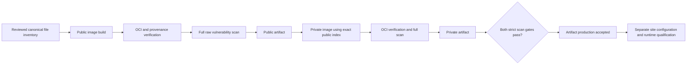

# Hosted runner image artifacts

`runner-image-artifacts.yml` builds the canonical Linux amd64 public runner and
private-mode derivative on two sequential, disposable GitHub-hosted workers.
It produces downloadable OCI archives and evidence, without publishing an image
or changing runner routing. The canonical Dockerfiles are unchanged.

**These artifacts cannot be deployed.** The guard CA is exactly the invalid text
`UNCONFIGURED SITE CA` followed by a newline. The workflow has no site certificate,
private key, registry credential or runner registration token. Its artifacts are
visible to readers of this public repository, so private configuration must never
be added to the workflow or its context inventory.

## Run and inspect

Use **Actions → Build nondeployable runner image artifacts → Run workflow** on
the default branch. Dispatches from other branches, private repositories,
self-hosted workers or non-amd64 workers are rejected. Runs are serialized and
never automatically cancel an earlier run.

The two artifact names include the exact run ID and attempt:

- `runner-image-public-<run-id>-<attempt>`
- `runner-image-private-<run-id>-<attempt>`

Each complete artifact contains `image.oci.tar`, `build-receipt.json`,
`oci-verification.json`, `cgroup-verification.json`, `scan.json`,
`scan-summary.json`, `scan-database.json`, the command log and disk observations.
Failure artifacts retain whichever evidence and partial output exists; a partial
archive is never accepted as an image. Artifacts expire after seven days. Copy
accepted archives and their complete evidence to the approved recovery storage
before expiry; the workflow does not perform that backup.

`build_success`, `oci_verified`, `scan_completed` and `scan_gate_passed` are
separate fields. A raw HIGH/CRITICAL finding does not erase successful build
evidence or block production of the private-mode image. After both artifacts are
uploaded, the final step fails if either scan contains any HIGH or CRITICAL
finding. All severities and package records remain in the raw report. The
workflow performs no automatic exclusions, including for the separately
documented runc applicability analysis.

## Source and artifact contract

`.github/containers/runner-artifacts.json` pins the canonical source, exact
context file SHA256 hashes, sizes and Git modes, plus immutable official BuildKit
and Trivy images. Build contexts are copied from committed Git blobs, not the
working tree or ignored files. Their contents must exactly match the canonical
inventory and each Dockerfile's deny-by-default `.dockerignore`. The invalid CA
is the only separately generated context file.

The image revision label is the actual dispatched `source_commit`. This can be
a later workflow/documentation commit, but every canonical build input must
still match the reviewed inventory. Updating a canonical input requires an
explicit manifest update and review; a changed recipe is never accepted by
merely changing the revision label.

The private job downloads only this run's public artifact and verifies its
source, run, attempt, manifest, context, complete OCI graph, scan and cleanup
evidence. It builds against that exact OCI index via a named context. The private
image must retain the public layer/diff-ID prefix and runtime configuration
apart from stage labels. All descriptors, compressed and uncompressed layer
hashes, the invalid effective CA and the build-provenance subject are checked.
This is integrity evidence, not a signed attestation or a runtime acceptance.

## Capacity and ownership

GitHub documents 14 GB of SSD for standard hosted workers; actual free space is
measured before using it. This workflow requires 10 GiB free to start each stage,
keeps a 2 GiB reserve on the workspace, temporary, Docker and containerd
filesystems, and checks it during commands and after successful command exits.
Private OCI materialization additionally reserves space for the archive size;
its downloaded tar is removed only after complete validation and materialization.
If a particular hosted image cannot fit, the run stops and retains evidence.
It does not delete preinstalled SDKs, unrelated images or other jobs' caches.

Each owned BuildKit container has two CPUs, 4 GiB RAM, no swap allowance beyond
RAM, no restart policy and one parallel build vertex. The workflow verifies the
actual cgroup v2 limits and private cgroup namespace, then performs a small
20-second RUN using the canonical pinned Ubuntu base. A host-side observer must
see that real RUN process inside the bounded builder cgroup. Limits and builder
identity are rechecked during the canonical build. HostConfig alone is not
accepted as enforcement proof. Each canonical build has a 45-minute deadline;
the scan has a separate bounded command and container. There is no retry loop.

Cleanup identifies the exact owned container before removing its immutable ID.
It still works after an OOM or low-disk failure. An ambiguous Docker response is
not treated as absence; removal requires a final absence readback. The scanner
receives only a read-only archive, writable cache and output directories, with
all capabilities dropped and no Docker socket. Cleanup never uses global prune.

## After artifact production

An operator must separately review the full scan, configure a site-specific
derivative, preserve its parent/child provenance correctly, run both actual
bootstrap profiles and qualify representative cold/warm jobs with memory and
disk evidence. A site derivative may replace only the invalid CA under its
separately reviewed contract. It must not copy the parent's attestation as though
it attested the new child digest. Neither the hosted workflow nor a successful
scan proves gVisor compatibility, physical deployment, or a suitable CI memory
limit. See [runner image security](RUNNER_IMAGE_SECURITY.md).
