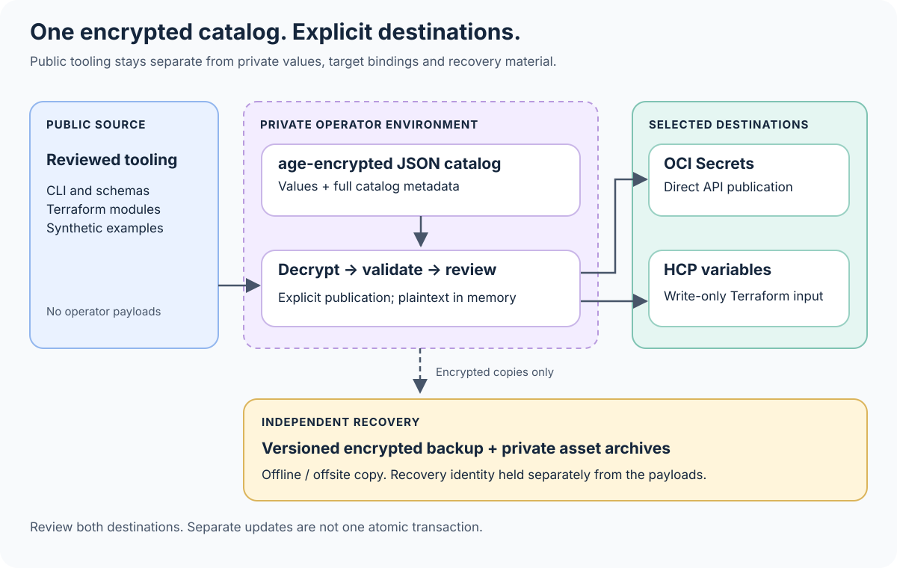

# Secret control plane

Keep reusable code public and operator data recoverable. The control plane reads
one local, age-encrypted JSON catalog and publishes selected entries to OCI
Secrets or HCP Terraform. The catalog's contents, including its names, target
bindings and generation metadata, are encrypted together. This design does not
require SOPS.

The public repository contains tooling, schemas, Terraform configuration and
synthetic examples. It must not contain an operator's catalog, decryption
identity, credentials, Terraform state, plans, publication receipts or backups.

## Start here

- [Bootstrap](SECRETS_BOOTSTRAP.md): establish keys, private storage and cloud access.
- [How to use the catalog](SECRETS_HOWTO.md): validate, plan and publish explicitly.
- [Recovery](SECRETS_RECOVERY.md): restore independently of either destination cloud.
- [Rotation and outages](SECRETS_OPERATIONS.md): handle changes, partial publication and compromise.
- [Synthetic examples](examples/secret-control/README.md): learn the format without real credentials.

## One source of recovery, explicit owners of rotation

The encrypted catalog is the recovery source for operator-managed values and
their approved target bindings. It is not proof that a credential remains valid.
The service that issued a token or password still determines validity; an expired
or revoked credential must be reissued. Record its owner, expiry and recovery
procedure in a separate encrypted operator runbook.

Choose one rotation authority for each entry. If a service rotates a value
autonomously, either adopt an explicit export-and-backup procedure before using
this publisher, or leave that value outside its management. Publishing an old
catalog must never be used to undo a newer rotation accidentally.

Catalog generation identifies a publication set; each entry's revision identifies
its value's intended version. Keep stable entry IDs. An operator reviews changes
to both values and destinations before publishing. A successful local plan is
not proof of account permissions, quota, destination health or consumer access.

## Separate the kinds of private material

**Credentials** are passwords, tokens and private keys. Publish each only to the
consumers that need it. Keep cloud administration credentials separate from
application credentials, and do not give an application the catalog decryption
key.

**Private configuration** includes internal endpoints, identities and topology.
It may fit in a catalog entry even when it is not an authentication secret. Its
availability and recovery rules still matter. A public example is not a fallback
for missing production configuration.

**Private assets** include models, source snapshots, media, measurements and
historical repositories. Store these in independently encrypted archives with
file inventories and restore instructions. The catalog can identify an approved
archive in a private runbook, but this tool is not a large-file backup system.

## Where Terraform fits

Terraform owns cloud topology and selected HCP variable resources. HCP secret
publication uses the provider's write-only value path with ephemeral inputs and
an explicit revision. OCI and HCP have separate Terraform roots, separate private
working directories and separate state. An HCP update must not plan changes to
an OCI vault or require OCI administration credentials.
Ordinary `sensitive` variables only hide display; they do
not automatically remove values from plans or state. Protect state even when
secret payloads are omitted: identifiers and topology remain sensitive.
[Terraform sensitive data](https://developer.hashicorp.com/terraform/language/manage-sensitive-data)

HCP values use an ephemeral, sensitive JSON string, so literal `${` and `%{`
sequences are preserved as data. HCP-targeted values must already be Unicode NFC:
non-NFC input is refused before cloud changes or local intent-ledger writes,
never normalized silently. HCP `env` values must also be single-line; carriage
returns and line feeds are rejected without stripping or encoding them.
Multiline values remain supported for HCP `terraform` variables and OCI targets.
See the [HCP value contract](SECRETS_HOWTO.md#prepare-and-publish-hcp-variables).

OCI payload publication uses the API rather than putting secret contents in
ordinary Terraform resource attributes. OCI and HCP updates are separate
operations, not one atomic transaction. Preserve a private publication record and
verify the intended consumers before declaring a rotation complete.

## Trust boundaries

The private operator machine and its selected tools are trusted. Plaintext exists
in process memory during decryption and publication. Encryption at rest does not
protect against a compromised operator account, debugger, malicious dependency or
screen capture. Use reviewed tool versions, a private working directory and a
quiet shell without tracing. Do not run the publisher in an untrusted pull
request job.

Consumers should receive the minimum value set and permissions they need.
Automatic workload identity federation, hosted deployment and consumer reload
or restart orchestration are not established by this local workflow. Adding any
of them requires a separate identity and authorization design.

## Capacity and cost

OCI currently includes **150 Always Free Vault secrets** across vaults in a
tenancy. Virtual private vaults are not part of that free allowance. Oracle lists
**25 KB as the maximum secret bundle size**. Count encoded payloads, destinations,
versions and other resources before adoption; these limits do not prove that a
particular catalog or entire deployment fits the free tier.
[Always Free resources](https://docs.oracle.com/en-us/iaas/Content/FreeTier/freetier_topic-Always_Free_Resources.htm),
[creating a secret](https://docs.oracle.com/en-us/iaas/Content/secret-management/Tasks/create-secret.htm)

OCI's native vault backup does **not** back up secret contents. Replication is an
availability feature and does not replace an independent, versioned backup.
[OCI vault and key backups](https://docs.oracle.com/en-us/iaas/Content/KeyManagement/Tasks/backingupvaultsandkeys.htm)

## Initial qualification — 2026-10-16

The focused local qualification passed **80 Python checks**: 49 CLI/catalog/OCI/HCP
contract checks, 10 private-file materialization checks, three real age
integration scenarios, eight Terraform contract checks, seven installer
boundary checks and three offline checks using the actual OCI SDK. The chart
groups the CLI, SDK and installer checks into one bar of 59. The eight Terraform
contract checks comprise six static checks and two tests using the real Terraform
environment-variable parser. Those two tests cover six exact-byte vectors and
13 invalid input shapes; the vectors and shapes are not counted as separate tests.

Separately, **18 Terraform mock tests** passed across the OCI and HCP roots.
These local checks use synthetic inputs; the SDK checks do not call the cloud.
The age tests use version 1.3.2 and cover recovery through a second recipient
after deleting the operator's test key, wrong-key/tamper refusal, and immutable
output/revision behavior.

A live **synthetic HCP experiment** also passed. It used an unattached, nonglobal
variable set with no consumers. Creation and generation-2 rotation used the
write-only path; the API kept the value sensitive and redacted, neither test
value appeared in local state, a repeated detailed plan reported no changes,
and the wrapper refused the old generation. State file bytes are not an
idempotency oracle: Terraform can update its serial or metadata without a
resource change.

A further synthetic HCP run verified the updated transport with a single-line
`env` variable and a multiline `terraform` variable. Literal `${` and `%{`,
quotes and NFC Unicode were accepted; a repeated detailed plan had no changes.
Both API values remained redacted and the test payloads were absent from state.
Old catalogs and multiline `env` values were refused locally. Exact value
transport was checked with the real Terraform parser tests; the sensitive HCP
API does not provide payload readback. The variable set remained unattached,
with no consumers.

A live **synthetic OCI experiment** also passed. It created a compartment,
vault and key, then verified secret creation and rotation by reading back each
published value. Repeating both generations produced no-op results, and an old
revision was refused. Fetching an explicit version verified an independent
content digest and an identical-file repeat. Decrypting the catalog with the
recovery identity and publishing it again also produced a no-op. No consumer IAM
grants were added and no existing consumers were changed.

One attempt immediately after rotation safely refused an ETag conflict without
an extra write. After the service settled, a fresh read-only reconciliation
allowed the no-op repeat. The conflict guard remained enabled; the successful
experiment does not promise that cloud updates are immediately consistent.

The hosted CI configuration adds Ubuntu/macOS coverage on Python 3.12 and 3.14
with real pinned age binaries. All four platform/Python combinations passed on
an earlier revision; that does not qualify the final source. Hosted results for the current revision
remain pending at this qualification point.

All live experiments use synthetic values. Recovery-key handoff to a password
manager remains a later operator step; it is not claimed as completed here.

These results establish the scenarios actually exercised, not production
migration, workload federation, application rollout or disaster recovery for an
operator's accounts. Use the runbooks to verify your own account recovery,
permissions, quotas and consumers before relying on them.
