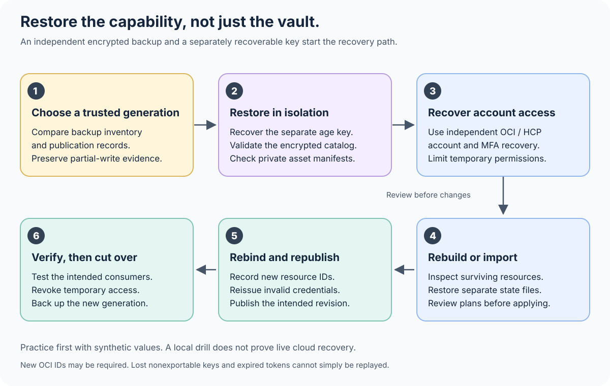

# Recovery runbook

[Architecture](SECRETS.md) · [Bootstrap](SECRETS_BOOTSTRAP.md) · [Rotation and outages](SECRETS_OPERATIONS.md)

Recovery succeeds when a replacement operator environment can restore an
approved generation and the intended consumers can use valid credentials.
Recreating a vault resource alone does not recover its contents, encryption keys
or dependent applications.

## Prepare the recovery kit before an incident

Keep these items outside the same failure domain:

- Versioned, whole-file encrypted catalogs, including the last known working
  generation and the latest intended generation. Record which actually reached
  each destination.
- A separately protected age identity, with access instructions and custodians.
  Possession of ciphertext without a usable identity is not a backup.
- Independent OCI, HCP and backup-account recovery instructions, including MFA
  recovery. These must not require retrieving their sole credential from the
  vault being restored.
- Reviewed source revision, tool/provider versions and dependency verification
  instructions. Preserve an installable trusted copy for an offline drill.
- Encrypted copies of Terraform state and private operation records where
  needed, plus independently encrypted private assets and their file manifests.
  For HCP, include `.secret-control-ledger-key` and all
  `.secret-control-intent-*.json` files with the corresponding state. An intent
  records an attempted generation; it does not prove a successful apply.
- A private binding map: logical entry ID, issuer, destination, consumer,
  revision, expiry and rotation authority. Keep actual identifiers out of public
  incident reports.

Preserve history without trusting it blindly. Ciphertext hashes detect a wrong
or damaged copy, but do not establish that an old generation is still current.
An approved generation record or a separately authenticated backup inventory
must distinguish a deliberate rollback from an accidental stale restore.

## Restore procedure

1. **Contain the incident.** Pause publications and automated rotations through
   their actual owners. If compromise is possible, use a clean operator machine
   and recover account access before exposing any restored plaintext. Preserve
   the failed environment for investigation under your incident procedure.
2. **Select a generation.** Compare the independent backup inventory, private
   receipts and issuer state. An in-progress or partial publication may have
   different revisions at different destinations. Do not call the newest file
   the last successful generation without evidence.
3. **Restore locally.** Place ciphertext and reviewed tooling in a new protected
   operator environment. Recover the identity through its separate custody
   path. Validate the catalog without printing decrypted values. Verify private
   asset archives against their manifest in a new isolated directory before
   allowing applications to read them.
4. **Recover the destination accounts.** Establish the minimum administration
   needed for recovery. Prefer short-lived recovery access where available;
   preserve an independent way to recover that access again.
5. **Restore or import infrastructure state.** Determine which resources survive.
   Restore protected Terraform state or import surviving resources before
   planning changes. Review names, permissions and dependencies. Do not assume
   an empty state means the corresponding cloud resources are absent.
6. **Rebind replacement resources.** Newly created OCI vaults, keys or secrets can
   have new identifiers. Update only the intended target bindings and consumer
   references in a reviewed catalog generation. Changing a resource name does
   not automatically update every consumer. HCP destination migration is a
   separate reviewed procedure; removing old bindings or discarding its
   ownership ledger to force acceptance is not supported recovery.
7. **Reissue what cannot be restored.** Ask the issuer for new expired, revoked
   or compromised credentials. A nonexportable key that was lost cannot be
   reconstructed from a Terraform declaration. Recovery may require replacing
   dependent certificates, ciphertext or trust relationships.
8. **Plan and publish deliberately.** Use the normal publication workflow for
   each destination. Treat any interruption as potentially partial; inspect
   receipts and destination state before a retry. HCP sensitive values cannot
   be recovered by reading the variable API, so do not use HCP as the source for
   rebuilding the catalog.
9. **Verify consumers before cutover.** Check the smallest safe operation that
   demonstrates the intended credential and destination work. Do not print a
   value to prove equality. Record exactly which consumer and revision were
   verified; a publisher response alone is not an application health check.
10. **Close recovery.** Revoke temporary recovery access and compromised old
    credentials, refresh encrypted backups, and update the binding map. Keep
    rollback material only for the approved retention period.

## Practice without a production dependency

Start with the [offline synthetic recovery exercise](SECRETS_DRILL.md). The
`drill` command generates disposable identities and catalog generations; it
accepts no production catalog, existing key or cloud account. Its success means
only that its local synthetic scenarios passed.

Use `recovery-check` separately when you have an approved encrypted catalog,
recovery identity, ciphertext digest and expected generation. The digest and
generation must come from a trusted inventory that is independent of the copy
being checked. A matching hash from a file stored next to an attacker-controlled
catalog is not independent approval.

An **offline drill** proves local decryption, validation and selected refusal
behavior. An **off-device restore** additionally proves retrieval from a backup
location and custody path that survive loss of the original device. A
**test-account drill** additionally exercises disposable cloud resources and a
test consumer with separately authorized credentials. None establishes
production recovery merely by completing the previous stage.

Record the date, source/tool versions, approved generation, scenarios, outcomes,
elapsed time and remaining dependencies. Store real-catalog records privately.
Agree a recovery time and maximum acceptable data loss, then measure them;
do not interpret a fast local drill as a complete account-recovery estimate.

## What a cloud backup cannot replace

Oracle's vault/key backup feature excludes secrets and software-protected keys;
it applies to supported virtual private vaults and HSM-backed keys. This design
therefore depends on its own encrypted recovery material, not a promise that
the free vault can export everything later.
[OCI backup scope](https://docs.oracle.com/en-us/iaas/Content/KeyManagement/Tasks/backingupvaultsandkeys.htm)

Secret replication can improve regional availability, but asynchronous replicas
and propagated deletion are not independent versioned recovery copies.
[OCI secret replication](https://docs.oracle.com/en-us/iaas/Content/secret-management/Concepts/secret-replication.htm)

HCP masks sensitive variables and does not return their values through the API.
Keep the encrypted source independently recoverable.
[HCP Terraform variables](https://developer.hashicorp.com/terraform/cloud-docs/variables)
