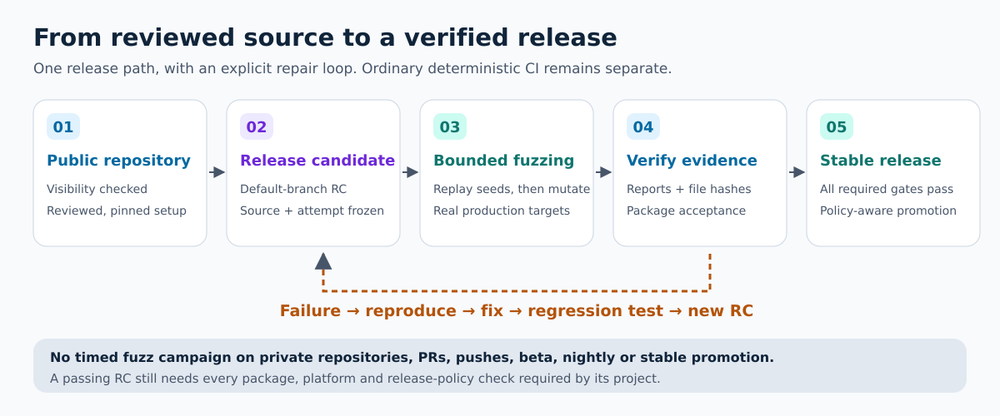
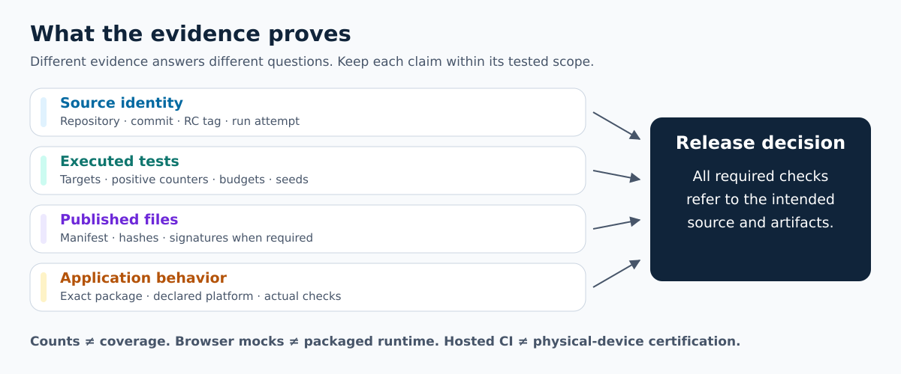
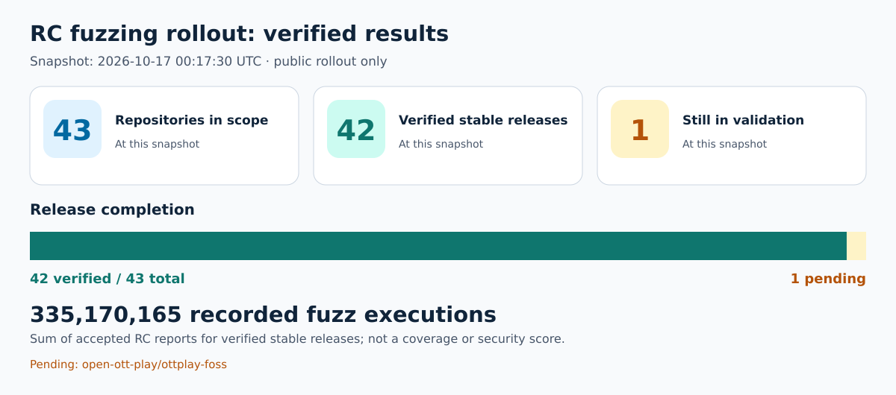
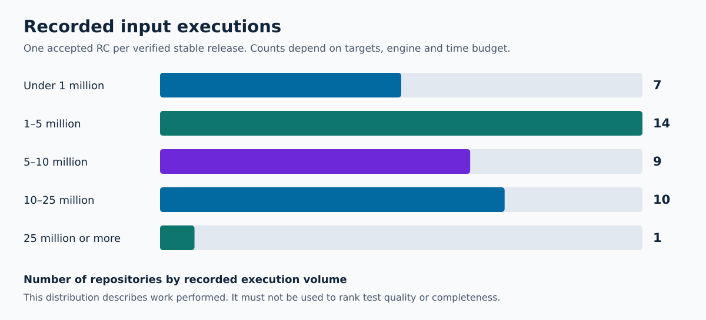

# RC fuzzing: process and verified results

The shared workflow exercises real application code with bounded input mutation
on public release candidates. This page explains the release path and records a
dated, verifiable rollout snapshot. It is not an OSS-Fuzz enrollment claim, an
OpenSSF certification, or a live status monitor.

## How a release progresses

1. Review the production targets, seed corpus, dependency locks and immutable
   toolkit references. The workflow checks that the repository is public.
2. Create an RC from the intended default-branch commit. Deterministic preflight
   and seed replay run before the bounded mutation campaign.
3. Run the declared fuzz targets. A successful process without positive engine
   execution counters cannot qualify the RC.
4. Check the report against the source, run attempt, manifest and artifact
   inventory. Complete the project's package and platform acceptance checks.
5. Promote the accepted bytes, or separately build and accept final-version
   packages when the project's policy requires final-build promotion.

Failures block qualification. Preserve the failing input and diagnostics,
reproduce the problem, fix it, add a regression test, and create a new RC.
An infrastructure retry must retain coherent source/run-attempt evidence.

Timed fuzz campaigns do not run on private repositories, pull requests, pushes,
beta releases, scheduled nightlies or stable promotion. Ordinary deterministic
CI and fixed regression tests keep their normal schedule. See the
[configuration, budgets and failure runbook](rc-fuzzing.md) for the exact rules.

## Results at 2026-10-17 00:17:30 UTC

**42 of 43 repositories have a verified stable release in this snapshot.**
Their accepted RC reports record **335,170,165 fuzz executions**. Counts describe
inputs exercised by the selected targets, not unique inputs, total program
coverage, vulnerability absence, or relative project quality.

The [machine-readable snapshot](rc-fuzzing-results.json) includes exact commits,
RC attempts, per-target counts, release links and run links. Each RC release
contains its published report and inventory. The table below links those public
records; it does not expose local paths, credentials or device data.

| Repository | Verified stable | Accepted RC | Recorded executions |
| --- | --- | --- | ---: |
| [4alvit/amazon-echo-home-voice](https://github.com/4alvit/amazon-echo-home-voice) | [v0.3.2](https://github.com/4alvit/amazon-echo-home-voice/releases/tag/v0.3.2) | [v0.3.2-rc.1](https://github.com/4alvit/amazon-echo-home-voice/actions/runs/38624965449) | 17,544,260 |
| [4alvit/dbus-service-template](https://github.com/4alvit/dbus-service-template) | [v0.1.2](https://github.com/4alvit/dbus-service-template/releases/tag/v0.1.2) | [v0.1.2-rc.2](https://github.com/4alvit/dbus-service-template/actions/runs/38843007034) | 1,151,719 |
| [4alvit/energy-data-rag-pipeline](https://github.com/4alvit/energy-data-rag-pipeline) | [v0.2.14](https://github.com/4alvit/energy-data-rag-pipeline/releases/tag/v0.2.14) | [v0.2.14-rc.1](https://github.com/4alvit/energy-data-rag-pipeline/actions/runs/38848005047) | 3,645,464 |
| [4alvit/esphome-ble-sensor-patterns](https://github.com/4alvit/esphome-ble-sensor-patterns) | [v0.1.2](https://github.com/4alvit/esphome-ble-sensor-patterns/releases/tag/v0.1.2) | [v0.1.2-rc.2](https://github.com/4alvit/esphome-ble-sensor-patterns/actions/runs/38843023904) | 60,038,032 |
| [4alvit/fastapi-mqtt-gateway](https://github.com/4alvit/fastapi-mqtt-gateway) | [v0.1.6](https://github.com/4alvit/fastapi-mqtt-gateway/releases/tag/v0.1.6) | [v0.1.6-rc.2](https://github.com/4alvit/fastapi-mqtt-gateway/actions/runs/38841476599) | 1,068,823 |
| [4alvit/google-home-voice-stats](https://github.com/4alvit/google-home-voice-stats) | [v0.3.2](https://github.com/4alvit/google-home-voice-stats/releases/tag/v0.3.2) | [v0.3.2-rc.2](https://github.com/4alvit/google-home-voice-stats/actions/runs/38843090794) | 3,707,986 |
| [4alvit/iot-project-builder-profile](https://github.com/4alvit/iot-project-builder-profile) | [v0.1.4](https://github.com/4alvit/iot-project-builder-profile/releases/tag/v0.1.4) | [v0.1.4-rc.1](https://github.com/4alvit/iot-project-builder-profile/actions/runs/38624571879) | 393,472 |
| [4alvit/mcp-venus-os](https://github.com/4alvit/mcp-venus-os) | [v0.2.15](https://github.com/4alvit/mcp-venus-os/releases/tag/v0.2.15) | [v0.2.15-rc.1](https://github.com/4alvit/mcp-venus-os/actions/runs/38847096885) | 5,435,237 |
| [4alvit/mqtt-observability-opentelemetry](https://github.com/4alvit/mqtt-observability-opentelemetry) | [v0.2.6](https://github.com/4alvit/mqtt-observability-opentelemetry/releases/tag/v0.2.6) | [v0.2.6-rc.1](https://github.com/4alvit/mqtt-observability-opentelemetry/actions/runs/38843038436) | 582,897 |
| [4alvit/solar-forecast-langgraph](https://github.com/4alvit/solar-forecast-langgraph) | [v0.1.6](https://github.com/4alvit/solar-forecast-langgraph/releases/tag/v0.1.6) | [v0.1.6-rc.2](https://github.com/4alvit/solar-forecast-langgraph/actions/runs/38842977539) | 19,916,507 |
| [ha-homelab/ha-desloc](https://github.com/ha-homelab/ha-desloc) | [v0.3.4](https://github.com/ha-homelab/ha-desloc/releases/tag/v0.3.4) | [v0.3.4-rc.1](https://github.com/ha-homelab/ha-desloc/actions/runs/38623993884) | 10,361,198 |
| [ha-homelab/ha-desloc-card](https://github.com/ha-homelab/ha-desloc-card) | [v0.1.4](https://github.com/ha-homelab/ha-desloc-card/releases/tag/v0.1.4) | [v0.1.4-rc.1](https://github.com/ha-homelab/ha-desloc-card/actions/runs/38623212194) | 90,200 |
| [ha-homelab/ha-echo-dot](https://github.com/ha-homelab/ha-echo-dot) | [v0.1.1](https://github.com/ha-homelab/ha-echo-dot/releases/tag/v0.1.1) | [v0.1.1-rc.1](https://github.com/ha-homelab/ha-echo-dot/actions/runs/38844159974) | 4,230,422 |
| [ha-homelab/ha-echo-show-5](https://github.com/ha-homelab/ha-echo-show-5) | [v0.1.1](https://github.com/ha-homelab/ha-echo-show-5/releases/tag/v0.1.1) | [v0.1.1-rc.1](https://github.com/ha-homelab/ha-echo-show-5/actions/runs/38623573394) | 2,399,910 |
| [ha-homelab/ha-lg-tv-capture](https://github.com/ha-homelab/ha-lg-tv-capture) | [v0.1.1](https://github.com/ha-homelab/ha-lg-tv-capture/releases/tag/v0.1.1) | [v0.1.1-rc.2](https://github.com/ha-homelab/ha-lg-tv-capture/actions/runs/38623855572) | 15,608,111 |
| [ha-homelab/home-assistant](https://github.com/ha-homelab/home-assistant) | [v0.1.1](https://github.com/ha-homelab/home-assistant/releases/tag/v0.1.1) | [v0.1.1-rc.1](https://github.com/ha-homelab/home-assistant/actions/runs/38624216769) | 42,522 |
| [ha-homelab/home-studio](https://github.com/ha-homelab/home-studio) | [v0.6.2](https://github.com/ha-homelab/home-studio/releases/tag/v0.6.2) | [v0.6.2-rc.1](https://github.com/ha-homelab/home-studio/actions/runs/38621294677) | 2,598,120 |
| [ha-homelab/k3s-self-healing](https://github.com/ha-homelab/k3s-self-healing) | [v0.1.4](https://github.com/ha-homelab/k3s-self-healing/releases/tag/v0.1.4) | [v0.1.4-rc.1](https://github.com/ha-homelab/k3s-self-healing/actions/runs/38865111145) | 24,191,531 |
| [ha-homelab/slzb-06-recovery](https://github.com/ha-homelab/slzb-06-recovery) | [v0.1.2](https://github.com/ha-homelab/slzb-06-recovery/releases/tag/v0.1.2) | [v0.1.2-rc.1](https://github.com/ha-homelab/slzb-06-recovery/actions/runs/38623608246) | 8,631,402 |
| [open-ott-play/ottplay-control-server](https://github.com/open-ott-play/ottplay-control-server) | [v0.1.2](https://github.com/open-ott-play/ottplay-control-server/releases/tag/v0.1.2) | [v0.1.2-rc.1](https://github.com/open-ott-play/ottplay-control-server/actions/runs/38844308604) | 2,381,115 |
| [open-ott-play/ottplay-core](https://github.com/open-ott-play/ottplay-core) | [v0.1.1](https://github.com/open-ott-play/ottplay-core/releases/tag/v0.1.1) | [v0.1.1-rc.2](https://github.com/open-ott-play/ottplay-core/actions/runs/38855119006) | 862,662 |
| [open-ott-play/ottplay-swop](https://github.com/open-ott-play/ottplay-swop) | [v0.1.1](https://github.com/open-ott-play/ottplay-swop/releases/tag/v0.1.1) | [v0.1.1-rc.1](https://github.com/open-ott-play/ottplay-swop/actions/runs/38624411868) | 3,881,630 |
| [victron-venus/dbus-emporia-vue](https://github.com/victron-venus/dbus-emporia-vue) | [v1.0.11](https://github.com/victron-venus/dbus-emporia-vue/releases/tag/v1.0.11) | [v1.0.11-rc.1](https://github.com/victron-venus/dbus-emporia-vue/actions/runs/38847825958) | 12,999,812 |
| [victron-venus/dbus-esphome-grid-sensor](https://github.com/victron-venus/dbus-esphome-grid-sensor) | [v1.0.6](https://github.com/victron-venus/dbus-esphome-grid-sensor/releases/tag/v1.0.6) | [v1.0.6-rc.1](https://github.com/victron-venus/dbus-esphome-grid-sensor/actions/runs/38847804786) | 8,847,442 |
| [victron-venus/dbus-ev](https://github.com/victron-venus/dbus-ev) | [v0.2.9](https://github.com/victron-venus/dbus-ev/releases/tag/v0.2.9) | [v0.2.9-rc.2](https://github.com/victron-venus/dbus-ev/actions/runs/38852043410) | 501,962 |
| [victron-venus/dbus-event-log](https://github.com/victron-venus/dbus-event-log) | [v0.2.3](https://github.com/victron-venus/dbus-event-log/releases/tag/v0.2.3) | [v0.2.3-rc.1](https://github.com/victron-venus/dbus-event-log/actions/runs/38849432521) | 11,281,361 |
| [victron-venus/dbus-mqtt-battery](https://github.com/victron-venus/dbus-mqtt-battery) | [v2.7.9](https://github.com/victron-venus/dbus-mqtt-battery/releases/tag/v2.7.9) | [v2.7.9-rc.1](https://github.com/victron-venus/dbus-mqtt-battery/actions/runs/38850852817) | 5,119,982 |
| [victron-venus/dbus-pump](https://github.com/victron-venus/dbus-pump) | [v0.1.8](https://github.com/victron-venus/dbus-pump/releases/tag/v0.1.8) | [v0.1.8-rc.1](https://github.com/victron-venus/dbus-pump/actions/runs/38850238318) | 456,583 |
| [victron-venus/dbus-tasmota-pv](https://github.com/victron-venus/dbus-tasmota-pv) | [v3.1.2](https://github.com/victron-venus/dbus-tasmota-pv/releases/tag/v3.1.2) | [v3.1.2-rc.1](https://github.com/victron-venus/dbus-tasmota-pv/actions/runs/38850125308) | 7,446,883 |
| [victron-venus/dbus-virtual-battery](https://github.com/victron-venus/dbus-virtual-battery) | [v2.7.11](https://github.com/victron-venus/dbus-virtual-battery/releases/tag/v2.7.11) | [v2.7.11-rc.1](https://github.com/victron-venus/dbus-virtual-battery/actions/runs/38850642695) | 7,023,563 |
| [victron-venus/integration-tests](https://github.com/victron-venus/integration-tests) | [v0.1.2](https://github.com/victron-venus/integration-tests/releases/tag/v0.1.2) | [v0.1.2-rc.1](https://github.com/victron-venus/integration-tests/actions/runs/38847810588) | 10,675,111 |
| [victron-venus/inverter-climate](https://github.com/victron-venus/inverter-climate) | [v0.4.2](https://github.com/victron-venus/inverter-climate/releases/tag/v0.4.2) | [v0.4.2-rc.1](https://github.com/victron-venus/inverter-climate/actions/runs/38847583595) | 17,029,487 |
| [victron-venus/inverter-control](https://github.com/victron-venus/inverter-control) | [v1.23.6](https://github.com/victron-venus/inverter-control/releases/tag/v1.23.6) | [v1.23.6-rc.1](https://github.com/victron-venus/inverter-control/actions/runs/38851157757) | 2,378,211 |
| [victron-venus/inverter-dashboard](https://github.com/victron-venus/inverter-dashboard) | [v1.8.28](https://github.com/victron-venus/inverter-dashboard/releases/tag/v1.8.28) | [v1.8.28-rc.1](https://github.com/victron-venus/inverter-dashboard/actions/runs/38866075738) | 9,389,550 |
| [victron-venus/inverter-dashboard-go](https://github.com/victron-venus/inverter-dashboard-go) | [v1.9.12](https://github.com/victron-venus/inverter-dashboard-go/releases/tag/v1.9.12) | [v1.9.12-rc.1](https://github.com/victron-venus/inverter-dashboard-go/actions/runs/38866178159) | 7,841,270 |
| [victron-venus/inverter-dashboard-vue](https://github.com/victron-venus/inverter-dashboard-vue) | [v2.2.8](https://github.com/victron-venus/inverter-dashboard-vue/releases/tag/v2.2.8) | [v2.2.8-rc.1](https://github.com/victron-venus/inverter-dashboard-vue/actions/runs/38861405495) | 3,307,140 |
| [victron-venus/inverter-desktop](https://github.com/victron-venus/inverter-desktop) | [v2.5.49](https://github.com/victron-venus/inverter-desktop/releases/tag/v2.5.49) | [v2.5.49-rc.2](https://github.com/victron-venus/inverter-desktop/actions/runs/38971254060) | 6,759,968 |
| [victron-venus/inverter-gateway](https://github.com/victron-venus/inverter-gateway) | [v0.4.3](https://github.com/victron-venus/inverter-gateway/releases/tag/v0.4.3) | [v0.4.3-rc.1](https://github.com/victron-venus/inverter-gateway/actions/runs/38847675693) | 17,245,877 |
| [victron-venus/inverter-monitoring](https://github.com/victron-venus/inverter-monitoring) | [v1.3.7](https://github.com/victron-venus/inverter-monitoring/releases/tag/v1.3.7) | [v1.3.7-rc.1](https://github.com/victron-venus/inverter-monitoring/actions/runs/38849771276) | 4,361,171 |
| [victron-venus/venus-os-ci-toolkit](https://github.com/victron-venus/venus-os-ci-toolkit) | [v0.1.3](https://github.com/victron-venus/venus-os-ci-toolkit/releases/tag/v0.1.3) | [v0.1.3-rc.1](https://github.com/victron-venus/venus-os-ci-toolkit/actions/runs/38869757913) | 4,248,875 |
| [victron-venus/venus-os-integration-patterns](https://github.com/victron-venus/venus-os-integration-patterns) | [v0.1.3](https://github.com/victron-venus/venus-os-integration-patterns/releases/tag/v0.1.3) | [v0.1.3-rc.1](https://github.com/victron-venus/venus-os-integration-patterns/actions/runs/38849076897) | 2,544,890 |
| [victron-venus/venus-os-observability](https://github.com/victron-venus/venus-os-observability) | [v0.1.9](https://github.com/victron-venus/venus-os-observability/releases/tag/v0.1.9) | [v0.1.9-rc.1](https://github.com/victron-venus/venus-os-observability/actions/runs/38847826472) | 6,947,807 |

For `inverter-desktop` v2.5.49, the initial final-package capture was blank at
60 seconds. A separate 120-second observation under AMD64 emulation showed
the Setup form at 90 seconds and the same rendered form at 120 seconds.
The [release acceptance notes](https://github.com/victron-venus/inverter-desktop/releases/tag/v2.5.49)
retain this limitation; these are software first-launch observations, not a
native startup-performance measurement or a 60-second startup guarantee.

### Still in validation

- [open-ott-play/ottplay-foss](https://github.com/open-ott-play/ottplay-foss): not counted as a verified stable release in this snapshot.

For `ottplay-foss`, native diagnostics confirmed an intermittent GStreamer
stream-start/flush stall on Ubuntu 24.04 (Noble). A backport of the upstream
[stream-synchronization fix](https://github.com/GStreamer/gstreamer/commit/03febb5048d0612157fad0ddadeaaeed924aadf0)
passed the isolated regression and a bounded native playback diagnostic.
Unpatched native runs can also pass; one successful run does not establish
that the race is absent. Corrected RC packages still require full acceptance.

Separately, a hosted Ubuntu 26.04 (Resolute) WebKit
[reload hang](https://github.com/open-ott-play/ottplay-foss/actions/runs/38980707356/job/117241012644)
was not reproduced in an
[isolated diagnostic](https://github.com/open-ott-play/ottplay-foss/actions/runs/38982549063)
and remains under investigation. The earlier
[browser comparison](https://github.com/open-ott-play/ottplay-foss/actions/runs/38962201111)
passed 20/20 scenarios on Resolute and 19/20 on Noble for that source and run;
those results do not qualify the current native release packages.

### Reading the limits correctly

- A fuzz counter proves recorded execution of declared targets; it does not
  measure every reachable path or establish that no defects remain.
- Source-built browser scenarios, especially those using IPC mocks, are
  separate evidence from running the actual packaged application.
- Package acceptance is limited to the tested architecture, runtime and
  scenarios. Hosted builds do not establish physical-device compatibility.
- Signatures are verified where the project's release policy requires them;
  the snapshot does not claim that every project signs its releases.
- A README “RC only” badge describes an enabled capability, not the last run's
  result. Use the linked run, report and release for evidence.

Update this dated snapshot and its SVGs only from verified release records.
Keep pending work visible and retain the previous Git revision; a newer default
branch commit does not retroactively change the source tested by a release.
